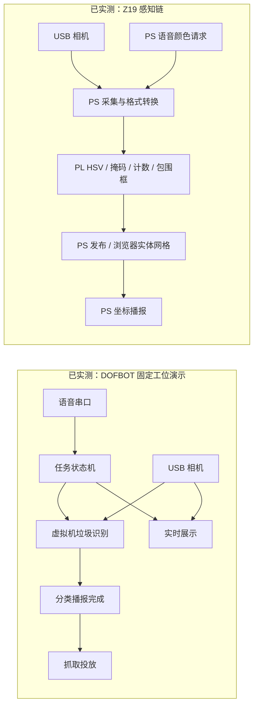
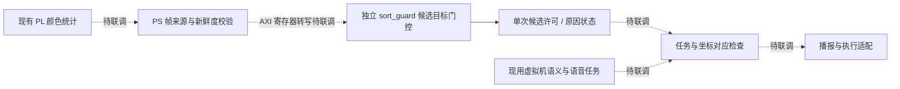

# VisionGrasp-Z19

### 面向固定工位的 FPGA 辅助感知与语音交互分拣平台

VisionGrasp-Z19 围绕“感知目标、确认任务、完成一次分拣”组织视觉、语音、FPGA 与机械臂软件。当前已完成语音驱动的 DOFBOT 实物演示，以及 Z19 上独立运行的 PL 颜色定位、实体网格坐标与播报；新增候选目标门控工程将空间、时间和任务约束表示为可验证的硬件规则。

[启动展示](docs/QUICKSTART.md) · [系统架构](docs/ARCHITECTURE.md) · [验证结果](docs/VALIDATION.md) · [参赛技术资料](docs/competition/README.md) · [开发指南](docs/DEVELOPMENT.md)

2026-10-30 新增[四功能 PS/PL 源码工程](fpga/system_pspl/README.md)：PL 视频通道校正/HSV/ROI 一阶矩和音频 DC/FIR/软门，PS 完整 PIO 收发、真实模型 CPU 后端、坐标映射、Vosk 与任务服务。实现文件、环境条件和源码交付范围集中在工程入口表；以下现场结果继续对应原部署版本。


*已部署版本的真实界面：现场画面、识别结果、语音记录与任务阶段同步显示。*

## 平台分工与当前成果

| 模块 | 核心工作 | 当前证据 |
|---|---|---|
| DOFBOT 语音视觉分拣 | 唤醒、单轮任务、垃圾语义识别、分类播报、固定工位抓取与展示 | 已有实物演示、用户确认与离线测试 |
| Z19 PL 颜色感知 | RGB→HSV、颜色掩码、像素计数、全局包围框 | 已有上板自检、真实相机帧与实现报告 |
| PS / 浏览器辅助 | 颜色语音请求、数据传输、实体网格映射、厘米坐标播报 | 已有现场记录；计算位置分别明确 |
| 新增候选目标门控 | ROI、匹配像素数、连续帧、位置抖动、超时与单次许可 | 软件 94 项、RTL 661 次断言检查通过；已完成 OOC 综合，尚未上板联调 |

PL 将颜色像素统计形成结构化候选数据，语音与任务软件负责解释用户意图和控制单轮流程。垃圾类别由现用虚拟机检测模块判断；当前 Z19 感知链与 DOFBOT 分拣链各自运行。



新增协同设计由 PS 读取现有 PL 统计并校验元数据，再通过 AXI 寄存器转写给独立门控模块，处理候选目标的时空约束。下图虚线表示后续联调连接；当前软件测试与 RTL 仿真不向现用机械臂发送动作。



工程接口与实际验证进度见 [sort_guard](fpga/sort_guard/README.md)，完整事实和可引用指标见[证据矩阵](docs/competition/EVIDENCE_MATRIX.md)。

## 一次唤醒，一次分拣

**“你好小亚” → “在的” → “开始垃圾分拣” → 准备观察 → 识别 → 分类播报 → 抓取投放 → 等待重新唤醒。**

- 每次唤醒与启动只执行一轮，忙碌期间的新语音不会排队触发下一轮。
- 连续稳定识别后先完成分类播报，再执行抓取投放；识别或播报失败不进入抓取。
- 控制进程独占设备，展示窗口复用同一相机数据，呈现类别、目标区域和动作指令阶段。
- 设备预检、进程身份核验、单实例启动与桌面入口统一管理，F11 可全屏展示。

当前使用已标定的固定拾取工位，无需深度相机。分类决定投放区域；任意空间动态抓取属于后续扩展。

## 启动展示

在已有 SDK、模型、音频和 ROS 2 Humble 的 Ubuntu 22.04 配套虚拟机中：

```bash
git clone --depth 1 https://github.com/Citlali6/VisionGrasp-Z19.git
cd VisionGrasp-Z19
bash robot/dofbot/install.sh --check
bash robot/dofbot/install.sh
```

安装不自动启动，运行实例会阻止覆盖。已部署环境直接运行：

```bash
bash ~/启动垃圾分拣.sh
```

也可双击桌面 **启动垃圾分拣 · 实时展示**。关闭窗口只关闭显示；结束后台功能使用 `bash ~/停止垃圾分拣.sh`。完整步骤见[快速开始](docs/QUICKSTART.md)。新增门控工程不更改该启动入口或现有运行程序。

## 仓库导航

| 目录 | 内容 |
|---|---|
| [robot/dofbot](robot/dofbot/README.md) | 定稿分拣、展示与安装 |
| [fpga/color_locator](fpga/color_locator/README.md) | 已实测 PL 颜色感知与坐标链 |
| [fpga/sort_guard](fpga/sort_guard/README.md) | 新增候选目标门控工程 |
| [fpga/camera_hw](fpga/camera_hw/README.md) | 独立 MIPI 相机硬件及已验证产物 |
| [host](host/README.md) | Z19 Linux 相机、音频采集支持 |
| [docs/competition](docs/competition/README.md) | 官方模板对应提纲、事实与指标、补采资料清单 |
| `tests/`、`tools/`、`deliverables/` | 离线验证、基础工具、固定版本交付物 |

团队工作集中于 PL 数据流与统计接口、候选目标约束、单轮任务编排、输入隔离、实时状态展示和可复现部署。第三方算术核心、检测模型、SDK 与素材的来源及许可见 [THIRD_PARTY.md](THIRD_PARTY.md)。项目自有代码采用 [Apache-2.0](LICENSE)，各第三方文件保留原声明。
