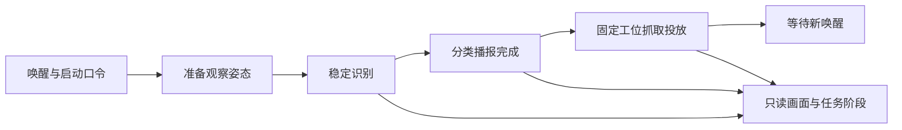

# 小亚智分 · VisionGrasp-Z19

**面向绿色生活实践与嵌入式开发的语音视觉分拣工作站。**

一件物品被放入正确的分类容器之前，需要完成识别、判断与投放。小亚智分把这三个环节组织成一套可参与、可观察的桌面交互：使用者发出指令，系统识别目标、播报类别，机械臂完成固定工位投放，界面同步呈现任务过程。

项目提供单次分拣任务软件与 Z19 PS/PL 感知工程，让公众参与一次完整分类操作，也让开发者沿着同一个任务理解图像处理、数字滤波、模型调用、接口通信和状态机。

**听见指令，看清目标，让分类落到行动。**

[项目概览](docs/overview.md) · [快速开始](docs/QUICKSTART.md) · [配置与部署](docs/CONFIGURATIONS.md) · [系统架构](docs/ARCHITECTURE.md) · [项目文档](docs/README.md)

*VM/DOFBOT 固定工位分拣界面。*

## 在哪里使用

| 场景 | 使用者与一次体验 |
|---|---|
| 校园绿色生活实践课 | 教师或志愿者准备支持的样本与固定工位。学生先判断类别，再放置样本、移开手并发出口令，观察分类播报与投放，围绕结果讨论分类依据。 |
| 社区低碳体验与公共展示 | 工作人员维护体验台，公众通过唤醒和启动口令发起一次任务，从窗口观察识别、播报和动作阶段；本轮结束后再接待下一位参与者。 |
| 高校嵌入式与机器人实践 | 学生开发者围绕同一分拣任务，逐层阅读视频算子、音频滤波、AXI/FIFO、PS 模型调用与 VM 执行接口，把算法和控制逻辑连接起来。 |

活动面向固定拾取位置、项目支持的样本或教具。组织方式与单件交互工位的扩展方向见[应用场景](docs/overview.md#应用场景)。

## 从一句话到一次投放

以下是现用 VM/DOFBOT 配置的一次任务：

1. 将样本放到固定拾取位置，移开手。
2. 说 **“你好小亚”**，听到 **“在的”** 后说 **“开始垃圾分拣”**。
3. 系统准备观察姿态，识别稳定目标，播报物品与类别。
4. 分类播报完成后，机械臂执行对应类别的抓取投放动作。
5. 任务结束，回到等待唤醒；下一位参与者重新发起任务。

*现用 VM/DOFBOT 固定工位任务流程。*

一次唤醒对应一次任务，忙碌期间的命令不会排队触发下一轮。识别超时或播报失败时，本轮不进入抓取。窗口共享控制进程的相机画面，显示识别结果、语音事件与已下发的动作阶段。

## 围绕任务组织软硬件

Z19 PS/PL 源码将采集、语义理解与任务通信放在 PS，把视频、音频的定点计算和候选规则放在 PL；可选 VM 客户端沿用机械臂 SDK 和固定工位任务。

| 功能 | PL 计算 | PS 软件与入口 |
|---|---|---|
| 视频预处理 | RGB 增益/偏置、HSV、掩码与流控 | USB/V4L2 解码、PIO 收发；[视频模块](fpga/perception_v2/README.md) |
| 垃圾识别分类 | 提供处理图像与候选规则 | CPU YOLO、前后处理和类别映射；[感知服务](host/app/perception/README.md) |
| 视觉定位与候选复核 | ROI 计数、包围框、一阶矩与连续帧规则 | 检测框中心、颜色质心、可选平面映射及候选适配；[系统工程](fpga/system_pspl/README.md) |
| 语音输入预处理 | DC、63 tap FIR、可选软门 | USB PCM、参数配置与 Vosk 受限命令；[音频模块](fpga/audio_frontend/README.md) |

默认 `semantic_bbox` 策略按同帧语义检测框的区域、面积与稳定性接受候选；`color_association` 用于明确要求颜色条件的工位。定位输出包含像素坐标，工作平面坐标使用相机绑定标定；机械臂执行使用固定拾取动作。完整数据路径与分配置连接图见[系统架构](docs/ARCHITECTURE.md)。

## 选择配置，开始使用

| 配置 | 适合做什么 | 当前交付 |
|---|---|---|
| VM/DOFBOT 固定工位分拣 | 体验语音发起、分类播报、机械执行与实时展示 | 已有现场记录；安装器默认使用[冻结安装源](deliverables/dofbot_demo_20261029/README.md) |
| 独立 Z19 颜色、语音与网格 | 阅读和复现 PS 采集、PL HSV/统计、浏览器网格及坐标播报 | 已有板端记录；使用该配置自己的镜像、地址与环境 |
| Z19 PS/PL 四功能源码 | 开发视频、分类、定位、音频及可选 VM 接口 | 源码交付，尚未联合部署；入口为 [system_pspl](fpga/system_pspl/README.md) |
| 独立 MIPI 相机与候选门控 | 阅读相机硬件工程、门控 RTL 及各自验证方法 | 原相机产物、独立门控仿真/OOC 报告；见 [FPGA 索引](fpga/README.md) |

从[配置与部署](docs/CONFIGURATIONS.md)确认环境、版本和依赖，再按[快速开始](docs/QUICKSTART.md)安装或启动。现用演示依赖配套 Ubuntu/ROS/SDK、模型与音频环境；四功能源码使用独立的板端工程和目标环境。测量数据与原配置的对应关系见[验证记录](docs/VALIDATION.md)和[证据矩阵](docs/competition/EVIDENCE_MATRIX.md)。

## 阅读设计与参与开发

| 想做的事 | 阅读入口 |
|---|---|
| 理解应用背景与使用流程 | [项目概览](docs/overview.md) |
| 了解系统分工和模块接口 | [系统架构](docs/ARCHITECTURE.md)、[FPGA](fpga/README.md)、[PS 软件](host/README.md)、[机械臂应用](robot/dofbot/README.md) |
| 阅读完整设计 | [设计报告](report/design_report.md) |
| 修改模块、准备检查和提交变更 | [开发指南](docs/DEVELOPMENT.md)、[Git 工作流](docs/GIT_WORKFLOW.md) |
| 复用开发方法 | [Skill 技能包](skill/README.md)、[AI 开发协作记录](report/ai_collaboration.md) |

所有文档从[项目文档](docs/README.md)进入。历史版本通过 Git 标签与 [Release](https://github.com/Citlali6/VisionGrasp-Z19/releases)保存。

## 来源与许可

项目自有代码采用 [Apache-2.0](LICENSE)。工程复用 Yahboom DOFBOT 配套 SDK、模型与动作能力、laperex HSV 算术、ALINX 板卡基础及 AMD IP，并保留历史工程来源。第三方代码、模型、媒体与工具遵循各自许可，取得方式与归属见 [THIRD_PARTY.md](THIRD_PARTY.md)。
