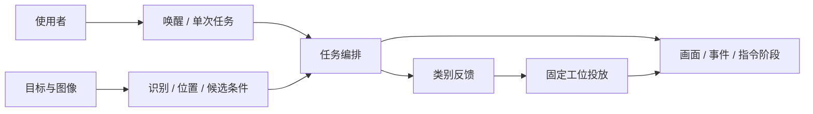

# 小亚智分 · VisionGrasp-Z19

### 基于 Z19 PS/PL 协同设计的语音视觉垃圾分拣工作站

**听见指令，看清目标，让分类落到行动。**

全国大学生嵌入式芯片与系统设计竞赛 2026 · AMD FPGA 创新设计赛道 · **3.3 自主选题初级组**。组别资格仍须按队伍最高年级/学历完成报名核对。

[评委导航](docs/competition/judges_guide.md) · [设计报告](report/design_report.md) · [四功能工程](fpga/system_pspl/README.md) · [已有成果](docs/competition/EVIDENCE_MATRIX.md) · [复现入口](docs/QUICKSTART.md)

*现用 VM/DOFBOT 配置的真实界面：图像、类别、语音事件与动作指令阶段。不是新四功能 profile 的联合运行截图。*

## 把分类知识变成看得见的过程

垃圾分类不应只停留在屏幕上的一个标签。小亚智分面向固定桌面工位，将语音交互、视觉识别、分类播报和机械执行组织成一次有始有终的任务。用户从一句“你好小亚”开始，在同一个窗口中看到目标类别与执行进程。

- **环保科普与课堂展示**：用固定工位、受控物块/教具演示分类与投放；校园和社区展台是目标场景，并非已落地客户。
- **嵌入式与 FPGA 教学**：从像素/PCM 数据流到定点算子、接口和状态机，提供可以逐模块阅读的工程。
- **创客实践与原型开发**：把感知、交互、执行和观察分开组织，为后续工位适配提供接口。

产品面向限定对象和固定拾取位置。当前不承担无序混合垃圾处理，不由类别名称推断具备危险废弃物处理能力。定位与已有方案差异见[产品说明](docs/competition/product_brief.md)。

## 一句话发起，一轮任务结束

**“你好小亚” → 等“在的” → “开始垃圾分拣” → 准备观察 → 稳定识别 → 分类播报完成 → 抓取投放 → 等待重新唤醒。**

任务状态机消耗一次唤醒，忙碌输入不积压为下一轮动作；播报失败不继续抓取。界面只读状态和共享画面，不成为第二个相机或控制器。

*产品功能图。具体运行配置与源码连接关系分别见下表及[系统架构](docs/ARCHITECTURE.md)。*

## 四项功能，一条清楚的技术主线

Z19 PS 负责采集、系统接口、模型和坐标解释；PL 负责固定精度的视频/音频计算及候选规则；VM 负责现有机械臂任务与 SDK 动作。

| 功能 | PL 计算 | PS 软件与代码入口 |
|---|---|---|
| 视频预处理 | RGB 增益/偏置、HSV、掩码、FIFO/背压 | USB/V4L2 解码、完整 PIO 收发；[视频模块](fpga/perception_v2/README.md) |
| 垃圾识别分类 | 提供处理图像和候选规则 | CPU YOLO、前后处理、真实类别映射；[感知服务](host/app/perception/README.md) |
| 视觉定位与候选复核 | ROI 计数、包围框、一阶矩、区域/连续帧规则 | 检测框、颜色质心、坐标恢复与可选平面映射；[工程连接](fpga/system_pspl/README.md) |
| 语音输入预处理 | DC、63 tap FIR、可选软门 | USB PCM、参数配置/回读、Vosk 受限命令；[音频模块](fpga/audio_frontend/README.md) |

[四功能数据流与环境表](fpga/system_pspl/README.md)集中给出寄存器、AXI/FIFO、C/ctypes、Tcl、目标时钟和外部依赖。分类模型在 PS CPU；工程使用 UIO/PIO。默认语义候选依据检测框面积，颜色对应仅在显式颜色工位模式中启用。坐标结果不自动变为机械臂基座坐标或任意位置抓取。

## 配置与成果对应

| 配置 | 用途与运行关系 | 成果/交付入口 |
|---|---|---|
| 现用固定工位演示 | VM 相机、外接串口语音、配套模型、分类播报和 DOFBOT SDK；原拾取动作 | [冻结基线与安装](docs/QUICKSTART.md)、[部署清单](robot/dofbot/deployment_manifest.json)；已有现场记录 |
| 原 Z19 颜色/语音/网格 | PS 采集与语音，PL HSV/掩码/统计，浏览器网格；独立于机械臂 | [颜色工程](fpga/color_locator/README.md)、[对应指标](docs/competition/EVIDENCE_MATRIX.md)；已有板端记录 |
| 四功能源码 profile | Z19 PS/PL 视频、模型、定位、音频及可选 VM 客户端 | [system_pspl](fpga/system_pspl/README.md)、[模型契约](host/app/perception/README.md)、[新 VM 入口](robot/dofbot/PSPL.md)；源码交付，未联合部署 |
| 独立 MIPI / 候选门控历史工程 | 分别保留相机镜像、独立门控仿真/OOC 及来源 | [FPGA 模块索引](fpga/README.md)、[证据矩阵](docs/competition/EVIDENCE_MATRIX.md)；不同 profile/报告范围 |

本轮只做源码小修、文档与 Git 收尾。没有运行工程验证或更新现场部署。四功能新 profile 的权重、类序、目标环境、UIO/新镜像、标定和 ASR 词典覆盖等条件统一见工程环境表；原始相机旁路不作为 PL 处理效果。

## 已有成果怎样阅读

| 想了解的成果 | 阅读入口与口径 |
|---|---|
| 完整交互体验 | [现场验证与真实窗口](docs/VALIDATION.md)：一次任务、播报后动作、共享相机与用户观察 |
| PL 视频与坐标 | [证据矩阵](docs/competition/EVIDENCE_MATRIX.md)：按原颜色 profile 的分辨率、帧率、延迟及图内残差条件引用 |
| FPGA 工程能力 | 同一证据矩阵中的原颜色完整实现、门控独立 OOC 和 RTL 记录，分别保留版本及约束 |
| 团队新增与复用边界 | [第三方说明](THIRD_PARTY.md)：任务/接口/流控/交付由团队组织，模型、SDK、机构和复用 IP 保留来源 |

数值以[证据矩阵](docs/competition/EVIDENCE_MATRIX.md)为单一事实入口。旧结果不转为新 profile 的加速比、定位精度或降噪收益；SDK 回调和 UI 阶段不当作物理抓取成功率。

## 参赛材料与可复用经验

| 材料 | 用途 |
|---|---|
| [评委导航](docs/competition/judges_guide.md) | 从作品价值进入技术、证据与复现 |
| [评分与要求映射](docs/competition/requirements_map.md) | 官方五项评分、七项报告内容与材料对应 |
| [设计报告](report/design_report.md) | 背景、原理、分工、优化、开发协作、技能和复现 |
| [大模型协作记录](report/ai_collaboration.md) | 基于真实提交/审计的开发纠错案例；区别于产品运行时 YOLO/Vosk 分工 |
| [Skill 技能包](skill/README.md) | 帧契约、寄存器事务、语音任务边界、只读观察；非 PYNQ Overlay |
| [英文海报内容稿](report/poster_copy_en.md) | 对应已有素材；未取得官方 PPT 模板，尚非排版成品 |
| [发布与恢复清单](docs/competition/release_inventory.md) | 历史入口、分支/PR 处置、命名兼容和恢复位置 |

## 选择配置后再复现

先读[快速开始的配置选择](docs/QUICKSTART.md)。现用演示安装使用单独的冻结提交 `8a2a6fd`；四功能源码使用本收尾分支，并按其依赖和独立入口准备。两类安装不能混用清单或覆盖现用 VM。

本候选发布位于 `source/track33-closeout-20261030`。[提交清单](deliverables/submission/manifest.json)记录源提交、profile、产物来源、报告和技能入口；main 的实际整合状态见[发布清单](docs/competition/release_inventory.md)，分支推送不代表 main 已更新。

## 工程目录对照

指南允许其他目录结构，本仓库保持实际源码与引用路径：

| 推荐角色 | 本仓库入口 |
|---|---|
| src：设计源码 | [fpga](fpga/README.md)、[host](host/README.md)、[robot/dofbot](robot/dofbot/README.md) |
| sim：仿真/验证 | 各 FPGA 模块原 sim 目录、`tests/`、`host/tests/`；本轮保留不运行 |
| build：构建与报告 | `fpga/system_pspl/*.tcl`、`host/libpspl/`，原报告见证据矩阵 |
| board：板端工程与输出 | `deliverables/`、原 profile 的 BOARD/模块说明 |
| data：参考数据 | 原日志、验证目录与证据矩阵链接，不生成替代数据 |
| skill / report | [技能包](skill/README.md) / [报告材料](report/design_report.md) |

普通新增文档采用小写英文文件名。指南命名文字与其 `README.md` 示例存在大小写差异；既有工具入口、第三方文件、设备兼容名和冻结产物保留原因见发布清单，不宣称已获得赛事豁免。

项目自有代码采用 [Apache-2.0](LICENSE)。第三方模型、SDK、HSV、板卡/IP 和媒体保留各自许可与外部取得条件，见 [THIRD_PARTY.md](THIRD_PARTY.md)。
