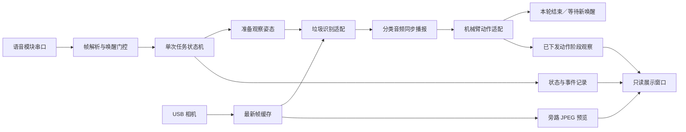
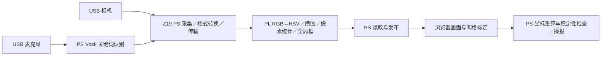
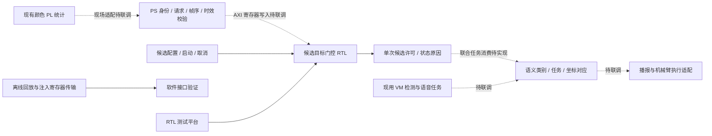

# 系统架构

平台按感知、任务与执行分工。当前 DOFBOT 与 Z19 颜色链分别完成实测；新增 `sort_guard` 是候选目标门控工程，尚未上板或接入现用分拣。已实现分工总图见[首页](../README.md)，以下细化运行链与新增设计。

## DOFBOT：语音驱动的单次任务

任务状态依次为等待唤醒、等待启动、准备、识别、播报、抓取投放、返回等待唤醒。每轮开始消耗一次唤醒状态；代际编号和输入清理阻止忙碌期间或上一轮的命令触发下一轮。唤醒有效期为 20 秒。

任务先执行既有的观察姿态准备，随后开始识别；准备动作发生在分类播报之前。识别适配仅在任务开始后运行。目标需在时间与位置约束下连续稳定出现三帧；最多识别 20 秒。音频调用阻塞至播放完成，失败不会继续抓取。当前采用固定拾取工位，识别类别选择四类投放动作。

### 控制与展示解耦

控制进程唯一拥有机械臂、语音串口和相机。显示线程旁路复制最新帧，以约 8 Hz 发布 JPEG 和元数据，不消费控制取帧游标。Qt 窗口只读取状态和预览，不直接打开硬件，也不提供点击触发运动的入口。

预览携带进程、会话、时间戳和帧序号。窗口核对运行进程与数据新鲜度；旧会话、编码失败或过期画面不显示为 LIVE。动作阶段通过成功下发的 SDK 调用观察，可显示抓取、转运、释放、返回，不将指令完成写成实际抓取成功。

### 启动与恢复

启动器统一完成设备与音频检查、ROS 环境准备、逆解服务就绪检查、后台进程启动和窗口激活。锁、进程启动时间和会话标识用于防止重复运行及旧状态误认。停止入口只对已核实的空闲实例发出正常退出请求。

## Z19：独立的 FPGA 感知链

颜色掩码、像素计数与全局包围框在 PL 内计算。语音识别和媒体传输位于 PS，实体网格交点检测与透视标定在浏览器执行；目标板面中心由板端结合有效标定重算。不同处理位置有各自记录，不把浏览器或 PS 算法标作 PL 运算。

这条链目前提供独立感知与坐标展示，不连接上述 DOFBOT 运动控制。MIPI/IMX214 相机工程是另一个独立硬件 profile，保留其专用 bit/XSA、内核驱动和采集证据。

模块接口与寄存器见 [颜色模块](../fpga/color_locator/README.md)，坐标定义见 [网格说明](../fpga/color_locator/GRID.md)。

## 新增工程：候选目标门控

原颜色链把 RGB 像素转为掩码、匹配面积和全局框。新增 `sort_guard` 面向这些结构化候选数据：PS 先读取统计并验证来源、请求和帧元数据，再通过独立 AXI 寄存器接口转写；门控核评估闭区间 ROI、匹配像素数范围、连续合格新帧、bbox 四边界相对本段首帧固定锚点的抖动、无有效新帧超时和单次许可。时钟周期超时与软件秒级数据时效分别配置。

实线表示工程内部接口或测试关系，虚线表示尚未接入现场的协同关系。软件回放和 RTL 测试是两种离线验证，不表示软件客户端已访问真实 AXI 外设。

### 输入职责

- **旧 PL**：颜色阈值、像素统计及全局包围框，保持当前已验证 bit。
- **PS 适配**：统计读取、可信会话/相机来源绑定、请求和新鲜度检查、候选快照转写。
- **新增 PL 门控**：候选区域和计数范围、连续帧稳定、抖动、超时、一次候选许可。
- **虚拟机应用**：现用垃圾语义、语音任务、分类播报与固定工位执行；本次不替换其部署。

来源与时效检查依赖可信调用方提供的身份及实际帧记录，不等同于 FPGA 验证图像来源。现有状态 JSON 尚不提供完整的相机/会话身份，现场接入需要显式适配。两套相机的坐标和语义对应也需独立验证，不能直接把颜色框当作垃圾类别或已标定抓取坐标。

### 验证与接入阶段

工程按接口定义、软件替身测试、RTL 仿真、指定器件综合逐项记录。候选许可属于应用协同条件，不是机械安全认证或急停电路。后续上板须建立独立受控构建、校验位流与寄存器身份，再验证实际统计转写、延迟与任务关联；完成这些步骤后才讨论接入动作。当前实现与报告见 [sort_guard](../fpga/sort_guard/README.md)，可引用指标见[证据矩阵](competition/EVIDENCE_MATRIX.md)。
