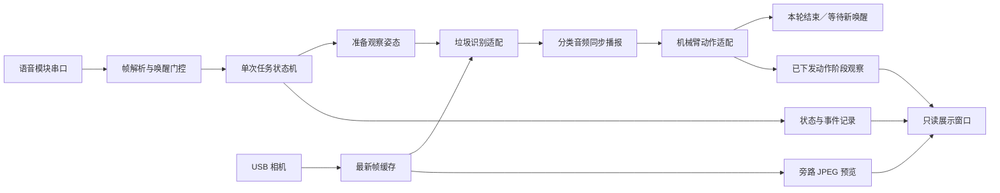
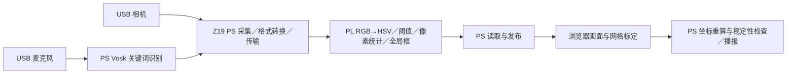

# 系统架构

## DOFBOT：语音驱动的单次任务

任务状态依次为等待唤醒、等待启动、准备、识别、播报、抓取投放、返回等待唤醒。每轮开始消耗一次唤醒状态；代际编号和输入清理阻止忙碌期间或上一轮的命令触发下一轮。唤醒有效期为 20 秒。

任务先执行既有的观察姿态准备，随后开始识别；准备动作发生在分类播报之前。识别适配仅在任务开始后运行。目标需在时间与位置约束下连续稳定出现三帧；最多识别 20 秒。音频调用阻塞至播放完成，失败不会继续抓取。当前采用固定拾取工位，识别类别选择四类投放动作。

### 控制与展示解耦

控制进程唯一拥有机械臂、语音串口和相机。显示线程旁路复制最新帧，以约 8 Hz 发布 JPEG 和元数据，不消费控制取帧游标。Qt 窗口只读取状态和预览，不直接打开硬件，也不提供点击触发运动的入口。

预览携带进程、会话、时间戳和帧序号。窗口核对运行进程与数据新鲜度；旧会话、编码失败或过期画面不显示为 LIVE。动作阶段通过成功下发的 SDK 调用观察，可显示抓取、转运、释放、返回，不将指令完成写成实际抓取成功。

### 启动与恢复

启动器统一完成设备与音频检查、ROS 环境准备、逆解服务就绪检查、后台进程启动和窗口激活。锁、进程启动时间和会话标识用于防止重复运行及旧状态误认。停止入口只对已核实的空闲实例发出正常退出请求。

## Z19：独立的 FPGA 感知链

颜色掩码、像素计数与全局包围框在 PL 内计算。语音识别和媒体传输位于 PS，实体网格交点检测与透视标定在浏览器执行；目标板面中心由板端结合有效标定重算。不同处理位置有各自记录，不把浏览器或 PS 算法标作 PL 运算。

这条链目前提供独立感知与坐标展示，不连接上述 DOFBOT 运动控制。MIPI/IMX214 相机工程是另一个独立硬件 profile，保留其专用 bit/XSA、内核驱动和采集证据。

模块接口与寄存器见 [颜色模块](../fpga/color_locator/README.md)，坐标定义见 [网格说明](../fpga/color_locator/GRID.md)。
