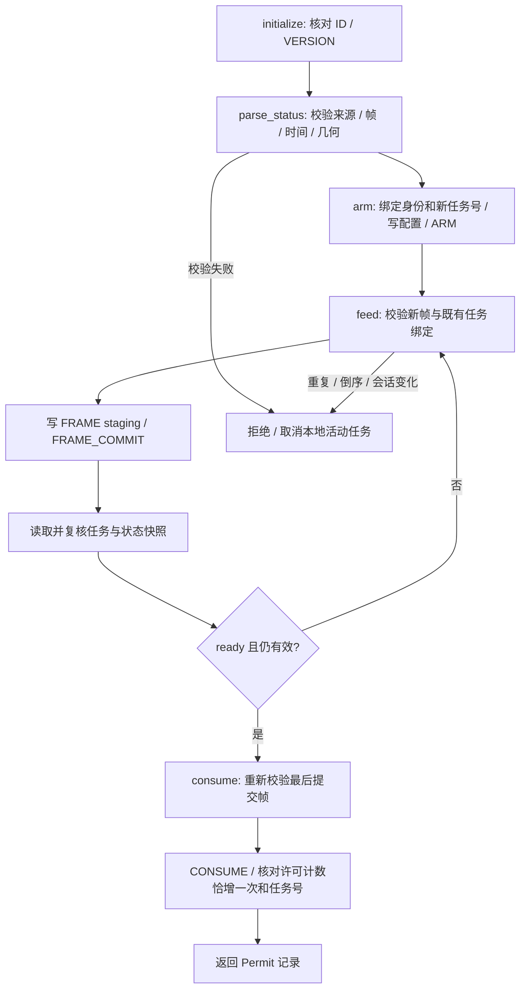
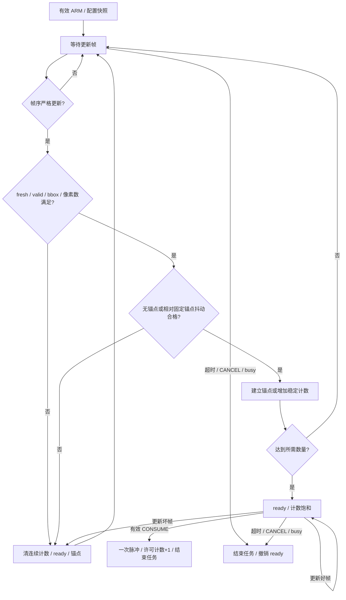

# 设计细节与接口写作素材

本页对应模板第二部分，提供从模块到流程的说明。现用程序细节见[系统架构](../ARCHITECTURE.md)；新增门控字段及优先级以 [INTERFACE.md](../../fpga/sort_guard/INTERFACE.md) 为准。

## 硬件/软件职责表

| 层次 | 输入 | 处理 | 输出 |
|---|---|---|---|
| 原颜色 PL | RGB888、SOF/EOL、颜色及 S/V 阈值 | HSV、阈值比较、掩码、统计 | 匹配像素数、全局 bbox、帧关联数据 |
| PS 统计适配 | 真实颜色状态及可信采集身份 | 来源、请求、相机/PL 序号、时间与几何一致性检查 | 已验证候选快照 |
| 新门控 AXI 包装 | 配置、候选字段、任务命令 | staging、ARM 配置快照、原子 FRAME_COMMIT、响应错误处理 | 状态、拒绝原因、许可计数与任务号 |
| 新门控核心 | 候选、ROI、像素数范围、稳定阈值、busy | 空间/时间约束与单次消费 | 单周期 `permit_pulse` 及可读取事件记录 |
| 虚拟机任务 | 语音事件、现用检测结果 | 单轮状态机、分类音频完成门控 | 现用固定工位动作调用与界面事件 |

新门控尚未分配板端物理地址。旧颜色统计先由 PS 读取，再计划转写到新外设；没有在现有视频流中插入已经上板的直连模块。

## 新门控的软件流程

`parse_status` 的 `now` 与采集/发布时间使用生产端同一单调时钟。`StreamIdentity(camera_id, session_id)` 由可信采集监督方显式提供，不能仅从来源不明的 JSON 自证身份。当前旧状态端点没有完整身份字段，现场接入需补充监督适配。

`GuardClient` 接收注入式 `read32/write32` 传输对象；这约束了总线访问顺序和错误传播。当前测试使用替身，不提供默认 MMIO 地址或执行器连接。`Permit` 表示经核对的寄存器许可事件，不等于实际运动完成。

## 新门控的 RTL 流程

- 帧序采用 32 位串行数比较，支持回绕；重复/倒序帧不会延长期限。
- ROI 检查要求整个 bbox 在范围内；像素数检查的是颜色掩码匹配数，单位不是平方厘米。
- 固定首帧锚点限制缓慢漂移，超过抖动阈值后从下一合格帧重新累计。
- `ready` 仅表示条件满足，必须接受 `CONSUME` 才产生一次许可。消费后需要新的 ARM；忙碌、取消或超时不产生许可。
- 超时以接入时钟周期为单位，边界优先于新的提交/消费。fresh+valid 新帧即使 ROI/像素数不合格也可证明新数据到达、刷新数据到达计时，但不能使 ready 有效。

框图是设计说明；验证覆盖与资源数字引用[证据矩阵](EVIDENCE_MATRIX.md)，不能仅凭图得出硬件已经联调。
