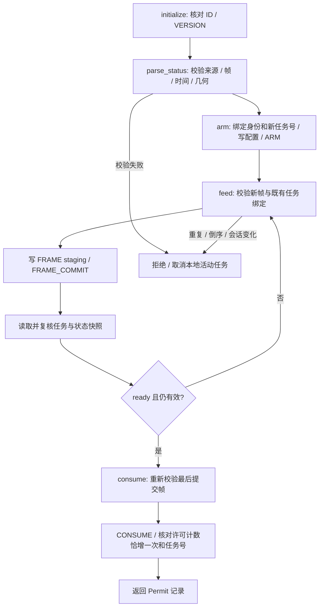
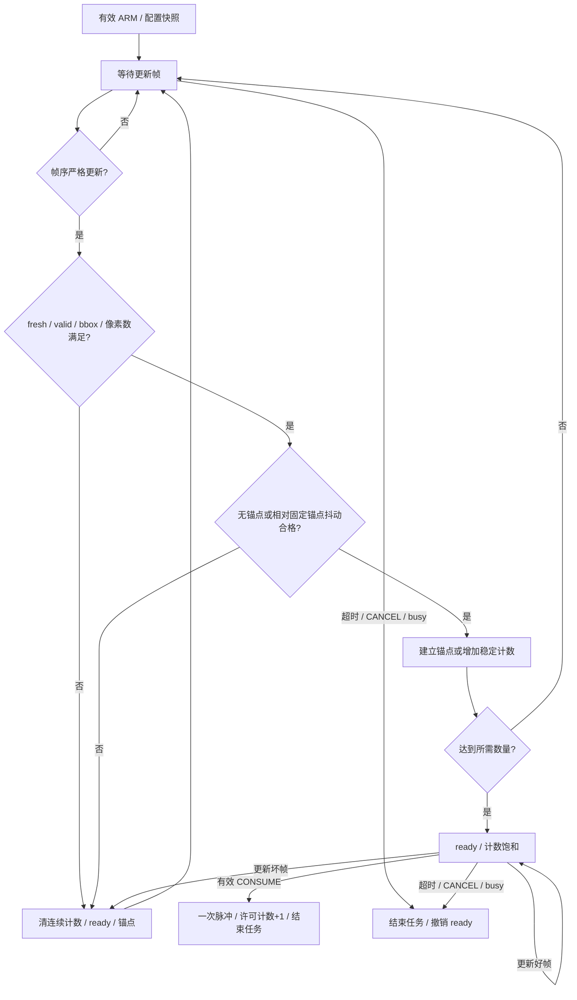

# 设计细节与接口写作素材

本页对应模板第二部分，提供从模块到流程的说明。现用程序细节见[系统架构](../architecture.md)；新增门控字段及优先级以 [INTERFACE.md](../../fpga/sort_guard/INTERFACE.md) 为准。

## 四功能 PS/PL 工程

Z19采用PS处理可变模型与系统接口、PL处理固定精度数据流的分工。PS通过C UIO有序MMIO交替填入/排出FIFO，完整回读RGB、mask和帧统计后才将图像送入CPU模型。新连接图及源码/运行环境集中见[system_pspl](../../fpga/system_pspl/README.md)。

| 功能 | 输入 → 关键计算 → 输出 | 工程连接 |
|---|---|---|
| 视频预处理加速 | RGB888 → Q8.8通道增益/有符号偏置/饱和 → 非高亮RGB；HSV范围比较 → mask | `vg_video_axi_top` / C `pspl_video_process` / `VideoFrontend` |
| 垃圾识别分类 | 同帧RGB → 厂商640×480缩放/BGR转换 → PS CPU真实YOLO/后端NMS → 类别、置信度、恢复框 | `Detector` / `ModelManifest` / `class_mapping`；加载不符即报错 |
| 视觉定位 | ROI掩码 → count/bbox/64位坐标矩 → PS质心、像素/平面坐标、唯一目标对应 | `vg_roi_moments_axis` / `CoordinateMapper` / 既有 `GuardClient` |
| 音频滤波与噪声抑制 | USB 16kHz mono PCM16 → PL DC/63tap Q1.15 FIR/软门 → PCM → PS Vosk白名单事件 | `vg_audio_axi_top` / `pspl_audio_process` / `PlAudioFrontend` / `UsbPcmPlSession` |

视频配置在accepted SOF形成完整active快照，输入排队、弹性RGB流水和自由运行HSV标签遵循各自握手/逐周期语义。一个帧完整消费后冻结结果，PS核对序号并ACK；末像素参与统计，坏帧不可冒充完整结果。默认语义任务由同帧检测框及面积复用PL连续帧门控，颜色统计独立返回；只有显式颜色工位策略才要求唯一颜色区域与语义框对应，颜色歧义不会隐式阻断默认垃圾任务。

语义模式的 `bbox_area_px` 在PS由整数框计算，颜色模式的 `pl_mask_pixels` 来自PL；结果携带策略与计数依据，双端核对。PL仍只检查数值区域/计数/连续帧/抖动/超时，不执行垃圾语义推理。新语音模式沿用“你好小亚”“开始垃圾分拣”及原命令编号语义，只有USB PCM进入PL滤波。新VM展示通过共享发布器输出状态、识别图片与日志，旁路原始远端图像不作为PL结果。

DC状态使用40位Q24.15，反馈乘积56位；FIR使用48位累加与对称符号舍入。软门用双阈值和按样本变化的UQ1.15增益，默认关闭。FIR系数需63项完整装载，在disabled且排空后commit；PCM块边界不清状态。PL统一100MHz目标逻辑时钟，16kHz为数据样本节拍。

PS服务仅输出感知/任务消息。独立VM入口沿用一次唤醒、准备观察、识别、分类播报和固定类别动作；新路径消费既有门控一次许可，旧入口保持原稳定判断。厂商旧xy是逆解代理坐标，新像素中心不会直接传入原 `.005` 判断。平面毫米坐标不会自动用于任意位置抓取。

## 硬件/软件职责表

| 层次 | 输入 | 处理 | 输出 |
|---|---|---|---|
| 原颜色 PL | RGB888、SOF/EOL、颜色及 S/V 阈值 | HSV、阈值比较、掩码、统计 | 匹配像素数、全局 bbox、帧关联数据 |
| PS 统计适配 | 真实颜色状态及可信采集身份 | 来源、请求、相机/PL 序号、时间与几何一致性检查 | 已验证候选快照 |
| 新门控 AXI 包装 | 配置、候选字段、任务命令 | staging、ARM 配置快照、原子 FRAME_COMMIT、响应错误处理 | 状态、拒绝原因、许可计数与任务号 |
| 新门控核心 | 候选、ROI、像素数范围、稳定阈值、busy | 空间/时间约束与单次消费 | 单周期 `permit_pulse` 及可读取事件记录 |
| 虚拟机任务 | 语音事件、现用检测结果 | 单轮状态机、分类音频完成门控 | 现用固定工位动作调用与界面事件 |

门控工程使用独立地址 `0xA1020000`，由 PS 转写新视频统计；该地址不修改旧颜色 ABI 或现用镜像。

## 新门控的软件流程

`parse_status` 的 `now` 与采集/发布时间使用生产端同一单调时钟。`StreamIdentity(camera_id, session_id)` 由可信采集监督方显式提供，不能仅从来源不明的 JSON 自证身份。当前旧状态端点没有完整身份字段，现场接入需补充监督适配。

`GuardClient` 接收注入式 `read32/write32` 传输对象；这约束了总线访问顺序和错误传播。当前测试使用替身，不提供默认 MMIO 地址或执行器连接。`Permit` 表示经核对的寄存器许可事件，不等于实际运动完成。

## 新门控的 RTL 流程

- 帧序采用 32 位串行数比较，支持回绕；重复/倒序帧不会延长期限。
- ROI 检查要求整个bbox在范围内；原颜色适配/显式颜色模式检查PL掩码匹配数，默认语义模式检查明示的PS检测框像素面积。二者单位和来源分别记录，均不是平方厘米。
- 固定首帧锚点限制缓慢漂移，超过抖动阈值后从下一合格帧重新累计。
- `ready` 仅表示条件满足，必须接受 `CONSUME` 才产生一次许可。消费后需要新的 ARM；忙碌、取消或超时不产生许可。
- 超时以接入时钟周期为单位，边界优先于新的提交/消费。fresh+valid 新帧即使 ROI/像素数不合格也可证明新数据到达、刷新数据到达计时，但不能使 ready 有效。

框图是设计说明；验证覆盖与资源数字引用[证据矩阵](EVIDENCE_MATRIX.md)，不能仅凭图得出硬件已经联调。
