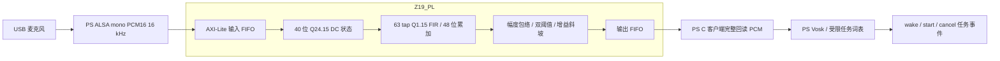

# USB PCM 的 PS/PL 音频前端

PL 顶层是 [`vg_audio_axi_top.v`](rtl/vg_audio_axi_top.v)，寄存器与流水连接在
[`vg_audio_frontend_axi.sv`](rtl/vg_audio_frontend_axi.sv)。USB ALSA 采集和 Vosk
识别在 PS；PL 依次计算直流抑制、63 tap FIR 和可选软噪声门。现用外接串口
语音模块提供命令编号；它不产生 PCM，原 `serial_id` 入口继续保留。

DC 算子将输入差扩展到 17 位，状态保留 15 个小数位，计算
`d[n]=x[n]-x[n-1]+32604/32768*d[n-1]`；40×16 位反馈乘法为 56 位。
反馈缩放、PCM 输出和 FIR 输出均采用最近舍入、半值远离零。状态与 PCM
采用饱和处理，剪裁事件累计到 `CLIP_COUNT`，计数在 uint32 最大值处饱和。
FIR 最坏累加幅值不超过 `63*32768*32768 < 2^36`，48 位有符号累加器覆盖此界。

[`coefficients.py`](../../host/app/voice/coefficients.py) 提供纯数学设计函数：
63 点 Blackman 窗带通 sinc，初始带宽 150..6500 Hz，在 1000 Hz 归一化后
量化到有符号 Q1.15。系数以 63 个小端 int16 的 SHA-256 记录配置身份。
函数在明确的 `PlAudioFrontend.open()` 初始化时调用；没有预置全零/恒等
系数作为运行替代。本次没有运行系数函数，也没有生成频响或衰减结果。

软门默认关闭。开启时，17 位幅度表示正确覆盖 `abs(-32768)=32768`；包络
瞬时上升，每个新样本下降 `max(envelope>>6,1)`。包络达到开阈值时开门，降至
关阈值时关门，中间区间保持状态。增益为无符号 UQ1.15，编码 `0..32768`，
可精确表示 0 和 1；开门每样本增加 attack_step，关门减少 release_step，
均在合法范围饱和。它衰减低幅度片段，没有实现谱减、波束形成或回声消除。

寄存器 ABI 为 1，设备 ID `0x56474132`。统一偏移见
[`registers.json`](../system_pspl/registers.json)；0x40 为 tap 索引，0x44 为系数，
0x48/4c 为开/关阈值，0x50/54 为 attack/release 步长，0x58 为 DC/FIR/gate
使能位，0x5c 为配置版本，0x60 为已装载 tap 数，0x64 为剪裁计数，0x68
低 5 位为输入 FIFO 占用、高 16 位起 5 位为输出占用。完成计数是已进入输出
FIFO 的样本数，输入/回读计数是实际 PIO 写入/弹出样本数，三者均按 uint32 回绕。

写事务只支持对齐的完整 32 位写入；零 WSTRB 无效果，部分 WSTRB 返回 SLVERR。
PCM 数据使用低 16 位的小端有符号样本位型，高 16 位必须为零。系数写入接受
高 16 位为零的原始位型，或正确符号扩展的 int16；不接受截断溢出。
输入满、输出空、非法地址或配置均立即结束 AXI 事务并返回错误，软件必须先查 STATUS。
`ERROR` bit0 表示被拒写入，bit1 表示被拒读取，bit2 为输入满时的被拒写入，
bit3 为输出空时的读取，bit4 为控制/配置提交被拒；写 1 清除，新错误优先保留。
满 FIFO 的拒写不覆盖旧样本。传输超时由 C 单调时钟 deadline 报 `ETIMEDOUT`
并标记句柄失效，没有将软件超时描述成硬件计时器。SLVERR 由 AXI 桥接
保留到响应被接受。AW/W 独立接收，输出 PCM 只在读取事务实际被接受时弹出。

配置顺序为 reset → disabled/empty → 装载全部 63 个 tap → 写软门/flags/版本
→ CONFIG_COMMIT → 核对 CONFIG_VALID/版本/ERROR → enable。配置在整个 FIFO
与计算流水排空后才切换，commit 会清除滤波历史；普通 PCM 块边界不清状态。
disable 仅阻止新 PIO 输入，队列中已有样本继续处理并须完整回读。enable 时没有
完整配置会被拒绝。会话 reset 清空流水、计数和配置有效位，之后须重新装载系数。

PS 包装是 [`pl_frontend.py`](../../host/app/voice/pl_frontend.py)，通过
[`libpspl`](../../host/libpspl/) C UIO 后端交替填输入与排输出，检查样本数与错误。
没有硬件时明确报错，不回退 CPU 后称为 PL 处理。超时或断流使该会话无效；必须
关闭并新建采集/ASR 会话，不能拼接旧状态。模块导入和构造不打开设备。

独立入口 [`usb_pcm_pl.py`](../../host/app/voice/usb_pcm_pl.py) 接受显式配置：
`voice_source="usb_pcm_pl"`、`library`、`uio_path`、`alsa_device`、`vosk_model`，
可附 `filter` 参数和 `min_confidence`。交互沿用现用演示：说“你好小亚”，等待
VM 完成“在的”回应，再说“开始垃圾分拣”。USB 词表不再包含“小助手”唤醒别名。
“开始分拣”保留为既有词表的兼容启动表达；“停止/取消任务”为 USB 模式受限取消
表达，不据此改写串口模块的命令词表。部分识别或低置信度不产生事件。

USB 的“你好小亚”映射到 `wake_id=1, legacy_command_id=0, language="cn"`；
两种启动表达均映射 `wake_id=0, legacy_command_id=92`，与现用串口记录的启动
事件一致。既有 `Session.handle()` 仍接受中文唤醒编号1..3、英文编号4..6，启动
编号92/108，保持20秒唤醒有效期、每轮重新唤醒和忙碌输入丢弃。本 USB 入口
只定义中文词表，不伪造英文识别。上述编号是向原任务层适配的字段；串口模式
仍解析外接模块的编号，只有 USB 模式的真实 PCM 才进入 PL 滤波。

事件携带音频源、session、块序、样本累计数、配置和系数哈希、任务
身份；生产端报告自身时效，接收端按本地到达时序处理超时。该入口不导入机械臂
SDK。新 PS 服务只选择一种语音事件来源，默认现用 serial_id 的部署保持原样。

USB 模式在 VM 接收器初始化及单轮任务开始、结束时，通过鉴权的 `/voice/boundary`
建立生产端边界。`request_boundary(timeout_s=8)` 串行处理请求，先中断当前
arecord 读取；生产线程丢弃在途 PCM 块，关闭旧采集进程及管道，重新打开 PL
滤波会话、清除滤波历史并 Reset 识别器，再启动新采集后才确认递增的
`boundary_id`。Vosk 模型复用，普通 PCM 块仍连续处理。每个事件携带其实际 ASR
调用所属的边界，旧事件不会被改写成新边界；服务和 VM 按已确认的边界过滤。
因此忙碌期的半句口令、管道缓存与旧 ASR 状态不能在任务结束后补成新唤醒。
边界失败或超时明确报错并使来源失效；停止/关闭会唤醒等待者并拒绝确认新边界。

词表初始化会按实际 Vosk 词典拆分中文短语；“你好小亚”和“开始垃圾分拣”任一
无法表示，或缺少可表示的取消表达时，明确报错，不静默改用其他唤醒词或只保留
短启动词。既有离线模型包只有 FST 图，没有独立 `words.txt` 文本词表；本轮只读
核对了包目录，未加载模型，尚未确认该模型对这两句口令的词典覆盖或识别效果。
识别调用与会话关闭时的 Reset 由同一互斥锁保护。

新 profile 使用统一 100 MHz 目标逻辑时钟，音频采样由握手表示。本轮仅交付源码
与文本审阅；未编译、仿真、运行、采音、播放或测量，不提供吞吐/降噪 dB 结论。
