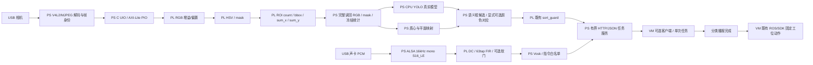

# 芯语智分 · Z19 PS/PL 四功能源码工程

本 profile 把像素与 PCM 的定点运算放在 PL，将采集、模型语义、坐标解释、ASR 和任务协议放在 PS。它使用独立地址空间与工程入口；现用 USB 颜色、MIPI/IMX214 和 VM 分拣入口保留。

本页说明集成源码的算子、数据路径、寄存器与构建入口。项目背景见[项目概览](../../docs/overview.md)，各配置的版本、工具、依赖和部署状态见[配置与兼容性](../../docs/CONFIGURATIONS.md)。

## 功能与接口

| 功能/层次 | 源码入口 | 输入与输出 | 设计要点 |
|---|---|---|---|
| 视频预处理 PL | [perception_v2/rtl](../perception_v2/rtl/)、[算法/流控](../perception_v2/README.md) | RGB888/SOF/EOL → 增益偏置 RGB、HSV 掩码、同帧统计 | 参数按帧快照；完整读回后确认统计 |
| 视觉定位 | `vg_roi_moments_axis`、[coordinates.py](../../host/app/perception/coordinates.py)、`guard_adapter.py` | ROI count/bbox/64 位矩 → 颜色质心；语义框 → 检测框中心、可选平面毫米坐标及候选状态 | 标定必须匹配相机/尺寸/transform；空掩码使颜色质心无效，不自动否决语义目标；复用原 sort_guard |
| PS 垃圾分类 | [detector.py](../../host/app/perception/detector.py)、前后处理、模型清单与类别映射 | 无标注 RGB → CPU YOLO 已 NMS 检测、真实 label 与业务编号 | 模型加载前核对权重、真实有序类名和框架契约；错误与成功空检测分别返回 |
| 音频 PL/PS | [audio_frontend](../audio_frontend/README.md)、[pl_frontend.py](../../host/app/voice/pl_frontend.py)、`coefficients.py`、`usb_pcm_pl.py` | 16kHz mono PCM16 → DC/FIR/可选软门 PCM → PS Vosk 受限任务事件 | 独立 USB PCM 输入；串口语音模块的命令编号直接作为事件输入 |
| PIO 与 Linux | [libpspl](../../host/libpspl/README.md)、`vg_axil_regs`、`vg_sync_fifo` | 独立 AXI-Lite AW/W 与 FIFO ↔ 有序 32 位 UIO MMIO | 显式设备路径；有序访问、交替收发、错误和超时传播 |
| PS 服务/VM | [service.py](../../host/app/perception/service.py)、[PS 模块说明](../../host/app/perception/README.md)、[可选入口](../../robot/dofbot/pspl_entry.py) | 带身份的图像/语音/任务 JSON ↔ 一次任务状态机 | 独立配置与输出目录；沿用 VM 分类播报和固定工位 SDK 动作 |
| 工程 | `create_project.tcl`、`build_bd.tcl`、`build_bitstream.tcl`、`profile.json` | PS、视频、音频、门控及统一时钟/复位/地址 | XCZU19EG、ALINX PS 配置、Vivado 2020.1 |

### 配置选择

本 profile 发布的是集成源码与接口，完整构建和联合上板状态见[配置与兼容性](../../docs/CONFIGURATIONS.md)。该页集中列出 AArch64 Linux、UIO、模型契约、相机标定、ALSA/Vosk 的准备条件，并与冻结 VM 演示、独立颜色和 MIPI 工程对应。产物及依赖来源见[提交清单](../../deliverables/submission/manifest.json)。

## PS/PL 连接



图：`z19-pspl-four-functions-v1` 集成源码连接关系。现用 VM/DOFBOT 演示的运行图见[系统架构](../../docs/architecture.md)。

PL 各运算、PIO FIFO、门控统一使用 `ps0/pl_clk1`，目标 100MHz；该值是配置目标，不是时序或板上测量。复位由同域 `proc_sys_reset` 输出。音频16kHz以样本握手表示，无派生采样时钟。门控 `external_busy` 在顶层固定为0，应用通过既有软件 busy/任务协议管理许可；没有机械臂输出引脚。

## 算法与事务

视频按 `clamp(((pixel*gain+128)>>8)+bias,0,255)` 逐通道处理，默认 gain=256/bias=0。HSV 算术复用未改动的 laperex MIT 源；新增包装提供任意合法阈值和无高亮 RGB。输入像素在 AXI FIFO 写入成功时计数；最终结果在 PS 实际读出时参与 ROI 统计。宽高最大4096×4096，count≤2²⁴，一阶矩<2³⁶，使用32/64位结果。末像素的 next 累加值直接进入快照。

视频 staging→校验 commit→pending→accepted SOF active 分层。一个完整帧及其输出/统计读完并 ACK 后，才接纳下一帧。快照冻结期间下游使用同一 active 参数。commit 与 SOF 同拍时先前 pending 生效，新 commit 留给下一帧；RGB 首像素立即使用所属帧参数。旧 HSV 核自由运行，其标签逐周期推进，以预留输出容量承受背压。

音频 DC 保留40位 Q24.15 状态、56位反馈乘积；FIR 为63tap Q1.15、48位累加；符号舍入采用最近、半值远离零。Blackman 窗带通设计函数在未来显式初始化时计算150–6500Hz初始带通并在1kHz归一化，不提交全零替代系数。63个系数装载并 commit 后才可 enable，参数只在 disabled 且 FIFO/流水排空时切换。软门默认关闭，双阈值迟滞、包络和 UQ1.15 增益0..32768提供精确0/1，attack/release按样本改变增益。块边界不复位；断流终止滤波和ASR会话。

PS 图像输入显式选择 `pl_rgb` 或 `raw_rgb`，记录两份内容哈希与像素空间。分类前不画框或高亮。模型返回框先从厂商640×480空间恢复到输入图像；颜色质心和检测框中心分别保留。平面单应变换不能当作机械臂基座三维姿态。

### 语义任务与颜色条件

双端显式配置并核对 `candidate_policy`。默认 `semantic_bbox` 面向垃圾语义任务：仅一个真实检测目标时，将同帧检测框覆盖的整数像素区域及其面积提交既有PL门控，检查ROI、面积范围、连续新帧、固定锚点抖动、超时和一次消费。颜色掩码为零或多连通区域仍照实输出，其状态不否决此模式。多个语义目标、来源失配、模型错误或几何/时效不合格仍不许可。

`color_association` 只用于显式要求颜色的工位：保留唯一语义目标、单个PL颜色连通区且完全位于语义框内的条件。它使用真实PL匹配像素数，缺少指定颜色时不适用。示例绿色阈值是颜色统计设计参数，不能作为所有垃圾类别的共同物理属性。

默认 `semantic_bbox` 返回 `association={state:not_requested,reason:semantic_bbox_policy}`，跳过颜色关联的掩码复制、ROI清零和连通区域分析；完整PL处理、回读、统计校验及独立颜色质心保持原接口。

两个模式共享原 `GuardClient` 寄存器事务及PL规则；语义适配仅替换PS输入校验，原RTL、寄存器ID/版本及旧颜色适配不改。语义数据的source为 `Z19_PS_CPU_YOLO`、count_basis为 `bbox_area_px`；颜色模式count_basis为 `pl_mask_pixels`。旧寄存器沿用 `mask_count` 名称，语义模式写入的是明示的检测框面积数值，不声称该面积由PL掩码统计得到。标签、模型或配置改变会取消本段并重新累计。

USB PCM与原串口交互统一为“你好小亚”唤醒、等待“在的”、再说“开始垃圾分拣”；两种源互斥选择。串口编号不经过PL FIR；只有USB PCM经过滤波后由PS识别。新VM入口复用原状态发布、识别图、事件日志和展示控件；独立输出目录与原部署隔离，相机预览通过明确标为原始采集的只读 `/preview` 旁路提供，不作为模型/PL结果或许可来源。

### 传输与性能口径

通道校正/HSV/统计在PL计算，端到端耗时还包含PS逐像素PIO、图像转换及CPU推理。`timeout_ms=5000` 配置传输截止，任务20秒上限和门控周期分别约束任务与候选等待；这些是配置参数。已有测量按对应配置见[验证结果](../../docs/VALIDATION.md)。

## 寄存器与传输

唯一寄存器定义为 [registers.json](registers.json)，C [registers.h](../../host/libpspl/include/registers.h)、RTL [registers.svh](rtl/registers.svh)是投影，Python 直接读取该 JSON。修改定义时用 `generate_contract.py`更新投影并审阅。字段详解见两个模块 README。sort_guard 保留自己的 ABI，版本为0x00010000；新视频/音频版本为1。

| 公共偏移 | 语义 |
|---|---|
| 0x00/04/08 | ID、协议版本、能力 |
| 0x0c | enable[0]、bypass[1]、reset[2]、commit[3]、视频snapshot ACK[4] |
| 0x10 | input_ready[0]、output_valid[1]、busy[2]、config_valid[3]、snapshot[4] |
| 0x14 | 错误 W1C，错误与清除同拍时保留新错误 |
| 0x18/1c | 自 reset 起累计输入/输出消费数，uint32回绕 |
| 0x20/24 | 数据写入/弹出，写满/读空报错 |
| 0x28/2c | 生效配置版本；视频完整消费帧数/音频产出样本数 |

数据事务使用对齐32位访问、全 WSTRB；非法地址和不支持的写法返回 SLVERR。AW与W分别锁存，B/R响应在停顿时保持；读副作用只在AR接受时执行一次。PS排输出、填输入交替推进，不依赖16像素批次。C层核对读写计数、视频SOF/EOL、帧号和快照有效位；快照读取后显式ACK。超时或数量/帧身份错误终止会话，需 reset/reconfigure，禁止把部分结果当完整结果。

## 地址与构建入口

[profile.json](profile.json)定义视频0xA1000000、音频0xA1010000、门控0xA1020000，各4KiB；Tcl使用其 [profile.tcl](profile.tcl)投影。设备树 [pspl-uio.dtsi](linux/pspl-uio.dtsi)对应相同规划。地址仅属于新profile，Linux集成者须核对保留区、实际UIO节点和map0大小，不得沿用旧设备节点或直接扫描地址。

准备匹配工具、目标环境和私有配置后，从仓库根目录使用以下入口。输出目录应位于源码树之外：

```bash
# 在匹配 Vivado 2020.1 环境，从仓库根目录：
vivado -mode batch -source fpga/system_pspl/create_project.tcl -tclargs /new/output/pspl
vivado -mode batch -source fpga/system_pspl/build_bitstream.tcl -tclargs /new/output/pspl/project/z19_pspl_four_functions.xpr /new/output/pspl/system_pspl.xsa
# 使用实际板端Linux sysroot；不是原VM x86库：
cmake -S host/libpspl -B /new/output/pspl-c -DCMAKE_TOOLCHAIN_FILE="$PWD/host/libpspl/aarch64-linux.cmake"
cmake --build /new/output/pspl-c
# 在新profile、设备树、库、模型清单和配置全部匹配之后：
python -m host.app.perception.service --config /explicit/pspl-service.json
```

PS程序面向Linux UIO，使用匹配目标Linux的工具链与sysroot。硬件集成使用本profile导出的XSA及对应设备树，不能套用独立颜色或MIPI平台的地址和镜像。

## 开发资料

从本页进入[PS 模块与模型契约](../../host/app/perception/README.md)、[视频](../perception_v2/README.md)、[音频](../audio_frontend/README.md)和[PIO 客户端](../../host/libpspl/README.md)。设计取舍见[设计报告](../../report/design_report.md)，检查入口见[开发指南](../../docs/DEVELOPMENT.md)，版本化结果见[证据矩阵](../../docs/competition/EVIDENCE_MATRIX.md)。
