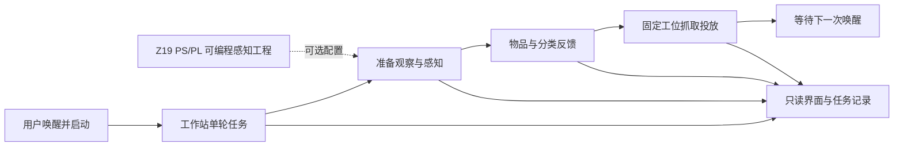
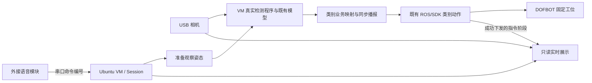
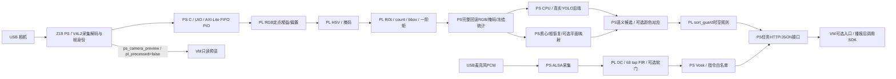

# 小亚智分——基于 Z19 PS/PL 协同设计的语音视觉垃圾分拣工作站

**听见指令，看清目标，让分类落到行动。**

参赛定位：3.3 自主选题赛道、初级组，实际资格由报名审核确认。硬件平台为 ALINX Z19，器件 `xczu19eg-ffvc1760-2-i`。本收尾稿继承四功能源码基线 `7cf7513a42d5b5f3b3c66eec1e950786b6478b83`；最终发布提交与主线整合状态以[发布清单](../deliverables/submission/manifest.json)为准。

本报告按用户提供的 2026 AMD 指南 3.3.5.3 的七项内容组织，规则页码、附件哈希与五项评分材料见[要求映射](../docs/competition/requirements_map.md)。配置/版本/环境集中于[系统工程表](../fpga/system_pspl/README.md)，指标只引用[证据矩阵](../docs/competition/EVIDENCE_MATRIX.md)，不为同一数字建立第二份维护表。

<a id="section-background"></a>
## 1. 选题背景与创新点

垃圾分类的交互展示需要让使用者理解一次任务如何从口令走向行动。小亚智分把唤醒、识别、分类反馈和机械执行组织成固定桌面工位上的单轮任务，并用只读窗口呈现过程。目标使用场景包括环保科普、嵌入式/FPGA 教学和创客原型展示；这些是产品面向的场景，尚无站点部署或教学效果评估记录。

现用记录覆盖固定拾取位置的单物块演示，物块材质与真实废弃物覆盖未形成核验清单。本稿保持限定演示对象的范围，不将模型的物品标签当作实际城市混合垃圾或危险废弃物的处理能力。

Yahboom 已有识别、语音播报和机械臂分拣教程，工业方案则面向连续物料流及回收设施。本作品沿用合法取得的检测模型、SDK、机构和既有动作，把团队贡献放在交互编排、可编程数据处理、接口一致性和工程复用。外部一手资料及差异分析集中于[产品简介](../docs/competition/product_brief.md)，来源责任见[第三方说明](../THIRD_PARTY.md)。

团队形成的主要设计包括：

- **有边界的任务**：一次唤醒/启动执行一轮，忙碌输入隔离，播报成功后才进入抓取；USB PCM 在任务边界确认新采音/滤波/ASR 代际。
- **有对应关系的数据**：相机、会话、帧、配置和像素空间逐级关联；原始采集预览、PL 输出与模型输入分开记录。
- **具体的 PL 运算与接口**：RGB 定点校正、HSV、ROI 一阶矩、DC/FIR/软门、FIFO/背压、AXI-Lite 事务及候选状态机。
- **可观察的工程**：控制进程拥有设备，显示旁路只读取数据；识别图、任务事件、运行身份和实际 SDK 指令阶段可追溯。


图1：现用 VM/DOFBOT 配置的真实界面记录，展示固定工位画面、类别、语音事件和任务阶段。该图对应原部署记录；图中的 LIVE 状态不是四功能源码 profile 的运行结果。完整物块/机构照片以实际取得且来源明确的素材为准。

<a id="section-principle"></a>
## 2. 设计原理与功能框图

### 2.1 产品功能关系



图2：产品功能图，表达用户体验和可选模块的功能位置，不表示全部配置已在同一现场同时运行。一次任务的实际顺序为“唤醒→启动→准备→识别→分类播报完成→抓取投放→等待唤醒”。

### 2.2 现用演示运行配置



图3：现用 VM 演示的运行关系。模型与任务运行在 VM，语音模块输出编号，机械臂沿用固定工位动作。原 Z19 独立 USB 颜色/网格工程另有自己的位流、地址与[板端记录](../fpga/color_locator/README.md)，不与此图拼成已经联动的系统。

### 2.3 四功能源码 profile 的连接关系



图4：`z19-pspl-four-functions-v1` 的源码连接图。像素/PCM 数据通过真实 PIO 路径进入 PL，YOLO 和 Vosk 在 PS CPU；预览旁路来自 PS 采集，不作为模型输入、PL 处理效果或任务许可。该 profile 的运行与依赖条件由系统工程表集中说明。

<a id="section-partition"></a>
## 3. 软硬件划分依据与接口设计

逐像素和逐样本运算具有确定的整数计算与数据次序，适合用 RTL 描述。采集解码、模型框架、词典和坐标配置更依赖 Linux 与软件环境，因此由 PS 组织；VM 保留现有任务、播报和机械执行依赖。完整入口为 [`fpga/system_pspl`](../fpga/system_pspl/README.md)，软件出口为 [`host/app/perception`](../host/app/perception/README.md) 与 [`robot/dofbot/PSPL.md`](../robot/dofbot/PSPL.md)。

### 3.1 视频预处理与完整帧统计

PS 把解码图像转换为 RGB888，每个 32 位 PIO 字含一像素、SOF 和 EOL。各通道执行：

```text
out = clamp(((pixel * gain_q8_8 + 128) >> 8) + bias, 0, 255)
```

gain 范围为 0..1024，默认 256；bias 范围为 -255..255，默认 0。乘法先无符号舍入，再扩展为有符号数加偏置，最后饱和。模型输入不包含显示用高亮、框线或背景压暗。HSV 算术复用固定版本的 MIT 源码，团队实现外围流控、阈值、配置与统计。

输入只在 ready/valid 实际握手时推进；自由运行 HSV 核的标签逐周期推进，并以信用预留保证结果 FIFO 容量。配置按 staging→校验 commit→pending→accepted SOF active 切换，整帧参数冻结，首像素立即使用所属配置。PS 交替填输入、排输出，不能先塞完整帧，也不沿用旧固定批次假设。

ROI 仅筛选统计，不裁掉像素流。统计包含 count、bbox、sum_x、sum_y：支持最大 4096×4096，32 位 count 足以覆盖像素数，64 位一阶矩覆盖最坏边界。PS 弹出完整帧末像素后才发布快照，累加包含最后一个像素。首个 SOF 前、行长/EOL 不符或未完整结束的帧不生成有效完整统计；读取快照并 ACK 后才接纳下一帧。细节见[视频模块](../fpga/perception_v2/README.md)。

### 3.2 真实分类、定位和候选

`Detector` 显式调用外部真实 Ultralytics CPU 后端，保留厂商外层 640×480 BGR 预处理约定；后端负责自身 letterbox、归一化和 NMS，PS 解码实际结果并恢复外层缩放。神经网络 class ID 顺序来自匹配权重/类序契约，业务类别映射不能替代模型类序。权重缺失、后端不匹配与空检测结果是不同状态。

定位分别保留检测框中心和颜色匹配像素质心：后者由 `sum_x/count`、`sum_y/count` 得到，count=0 时为空。平面映射采用带相机、图像尺寸、transform 与 calibration_id 的单应矩阵；无匹配标定保留像素坐标和原因。桌面 `table_xy_mm` 不解释为机械臂基座三维姿态。

默认 `semantic_bbox` 把唯一真实检测目标的整数框区域及 `bbox_area_px` 交给既有 PL 门控。`color_association` 才执行 ROI 掩码清零、连通区域及包含关系检查，并使用 `pl_mask_pixels`。默认模式输出 `association.state=not_requested`、`reason=semantic_bbox_policy`，不调用仅用于颜色对应的连通域分析；PL 完整回读、统计合法性和来源/时效校验仍保留。

门控复用 ROI、面积范围、连续合格新帧、固定首帧锚点抖动、超时和一次消费。来源/会话失配、帧身份异常，或标签、模型和配置改变时取消或重建候选段；普通连续新帧按规则累计。许可是任务数据，不代表夹持成功或机械安全认证。现有 SDK 类别动作继续使用固定拾取位置，不把新像素中心代入任意位置抓取。

### 3.3 语音与数字滤波

串口语音模式读取外接模块编号；USB PCM 模式读取 16 kHz、mono、S16_LE 音频，经过 PL DC、63 tap FIR 和可选软噪声门后由 PS Vosk 解析白名单事件。两者互斥选择，交互语义统一为“你好小亚”及“开始垃圾分拣”。

核心计算为：

```text
d[n] = x[n] - x[n-1] + (32604/32768) * d[n-1]
z[n] = sum(h[k] * d[n-k]), k=0..62
```

DC 使用 40 位 Q24.15 状态与充分扩展的反馈乘积；FIR 系数为 Q1.15、48 位累加。纯数学设计函数提供 Blackman 窗带通 sinc 系数，初始频带为150–6500 Hz、在1 kHz归一化，完整装载并 commit 后才使能。软门以双阈值、包络和逐样本 attack/release 改变 UQ1.15 增益，默认关闭；定点舍入统一为最近、半值远离零。普通 PCM 块边界保持状态，断流或任务语音边界重建采音/滤波/ASR 代际。参数、位宽与源码见[音频模块](../fpga/audio_frontend/README.md)，本报告不把参数写成降噪效果。

### 3.4 公共传输、服务和只读展示

寄存器偏移与位字段由[单一清单](../fpga/system_pspl/registers.json)定义；AXI-Lite 独立接收 AW/W，保持 B/R 响应，非法访问显式报错。C 客户端通过显式 UIO 节点执行有序 32 位 MMIO，核对设备 ID、协议、容量、读写数量和帧标签。超时/断流终止会话，不把部分结果当完整帧或静默切为软件处理。

PS 服务和 VM 客户端按 task/session/frame 绑定 JSON，使用显式地址、限长报文与超时。只传生产端年龄，接收端叠加自身请求耗时，不直接相减跨机单调时钟。新 VM 入口接入原状态与识别图回调，使用独立输出目录；预览图、来源身份与 generation 同快照对应。旧部署安装器及冻结清单继续对应其原版本。

<a id="section-optimization"></a>
## 4. 优化过程及性能/资源对比

优化材料按相同统计范围组织。所有可引用数值及其原始报告入口以[证据矩阵](../docs/competition/EVIDENCE_MATRIX.md)为唯一维护位置；下表说明比较对象和设计判断，不复制一份独立数字表。

| 对象 | 原路径/基线 | 改进或取舍 | 对应结果与比较条件 |
|---|---|---|---|
| 旧 Z19 颜色系统发布 | hd 模式以 1280×720 进入 PL | balanced 保留原视野，降低 PL 处理尺寸至 640×360 | 见矩阵“原 hd 发布”“balanced 发布率/采集至发布”；分辨率不同，描述为系统取舍，不计算同画质算法加速比 |
| 控制与界面争用 | 控制拥有相机与取帧语义 | 实时画面使用不消费控制游标的旁路，状态和图片独立发布 | 见矩阵“语音任务与展示”及部署记录；不把界面在线状态当作物理抓取成功率 |
| 默认语义候选 | 原源码仍执行仅用于颜色关联的掩码复制和连通域分析 | 本收尾版本仅在显式颜色模式执行；语义分支保留结构化 `not_requested` 状态 | 本轮为源码修正，没有运行耗时或吞吐对比 |
| 定点与资源选择 | 像素流、音频流、候选状态机计算性质不同 | FIR 使用时分复用乘加，有限 FIFO 按握手流控，位宽按边界推导 | 新 profile 只有设计/源码依据，无新完整资源和时序结果 |
| 原有资源报告 | 旧颜色完整实现与门控独立 OOC 分别存在报告 | 按各自顶层、器件、约束和报告阶段引用 | 见矩阵“原颜色链完整实现”“门控综合资源/综合网表时序”；两组数字不相加、不当作优化前后 |

现有应用反馈、独立板端颜色/网格记录、软件/RTL 检查和资源报告均保留其原版本。四功能 profile 仍缺完整板级实测输出、相同输入的参考比对、新完整实现资源/时序与功耗记录；现有资料不足以给出新系统的识别准确率、加速比、毫米级外部精度或降噪 dB。

<a id="section-ai"></a>
## 5. 大模型协作记录

大模型协作用于开发与审阅，不是把运行时 YOLO、Vosk 与 PL 分工改名。真实案例、任务出处、用户审计、修正提交与材料完整性见 [AI 协作记录](ai_collaboration.md)。本报告使用可追溯的案例摘要，不补写未保存的逐字回答或推测模型版本。

| 开发中的发现 | 人工判断与修订 | 可追溯记录 |
|---|---|---|
| 指定颜色成为所有垃圾共同门槛 | 默认选择语义框候选，显式颜色模式保留其适用条件 | [颜色策略案例](ai_collaboration.md#case-color-policy) |
| 唤醒词不一致、旧 PCM/ASR 可能跨任务完成 | 统一用户命令，区分串口和 PCM，增加生产端代际边界确认 | [语音边界案例](ai_collaboration.md#case-voice-boundary) |
| 可选入口缺少展示与日志、图像来源可能错配 | 接回原发布器/控件，独立状态路径，锁定图片与来源身份 | [只读可观测性案例](ai_collaboration.md#case-readonly-observability) |
| 模型环境参数被猜测或混用 | VM 来源与 AArch64 目标环境分离，按实际资料登记并严格核对 | [模型契约案例](ai_collaboration.md#case-model-contract) |

协作流程为任务约束与源码输入→Codex 形成工程→用户/人工审计指出矛盾→按证据修改→保留差异、出处与失效条件。本轮没有以运行新程序证明修订效果，开发结论限于源码与接口审阅。

<a id="section-skill"></a>
## 6. 技能包提炼过程

技能以陌生队伍能否复用为组织原则，不复制整套工程。每项写明输入/输出、步骤、可改参数、失效条件、来源观察和已有证据；普通 Skill 是本赛道提交要求，通用 PYNQ Skill 是独立加分方向。当前 UIO/PIO 工程没有伪装为 PYNQ Overlay。

| 技能 | 从何处提炼 | 跨题目可复用的部分与边界 |
|---|---|---|
| [stream_frame_contract](../skill/stream_frame_contract/SKILL.md) | 原颜色核自由运行、背压标签与完整统计的工程经验 | 帧契约、信用预留、SOF 参数快照；需重新确认算子延迟和最大帧尺寸 |
| [register_contract](../skill/register_contract/SKILL.md) | AXI 地址/数据独立握手与寄存器投影一致性 | 单一定义、事务原子性、错误/超时及收发次序；不替代目标平台实际 MMIO 映射 |
| [voice_task_boundary](../skill/voice_task_boundary/SKILL.md) | 一次任务与忙碌输入、旧采音/ASR 事件跨代际问题 | 事件身份、边界确认、取消与重复处理；串口和原始 PCM 必须分别适配 |
| [readonly_observability](../skill/readonly_observability/SKILL.md) | 控制与 UI 争用、旧图片/新身份不一致问题 | 单一设备所有者、旁路、进程/会话/图像一致性；显示证据不等于物理成功反馈 |

原颜色链和 DOFBOT 的既有记录可说明经验来源；新生成器、新边界及新 profile 本轮只有源码审阅。尚无跨题目、跨板运行数据，复用范围与效果不能凭文档数量扩大。

<a id="section-reproduce"></a>
## 7. 从零复现说明

以下是供后续使用者执行的步骤，**本轮未执行其中的安装、构建、程序、设备或验证流程**。必须先选择复现对象；旧演示、旧 Z19 独立 profile 与新四功能 profile 不共用验收结论。

1. **取得并固定版本。** 从唯一仓库获取源码，按[发布清单](../deliverables/submission/manifest.json)记录当前交付 SHA。复现原 VM 演示安装时，另建工作树固定到 `8a2a6fd544cb6b79e868b8a710dc34b6027c6c8d`，该版本与冻结安装文件清单匹配。当前源码中的展示控件已为新入口扩展，不能直接当作冻结安装器的原输入。

   ```bash
   git clone https://github.com/Citlali6/VisionGrasp-Z19.git
   cd VisionGrasp-Z19
   git switch --detach origin/source/track33-closeout-20261030
   git rev-parse HEAD
   # 将实际解析的 SHA 与发布清单/交付说明核对，再单独取原演示安装源：
   git worktree add ../visiongrasp-demo-20261029 8a2a6fd544cb6b79e868b8a710dc34b6027c6c8d
   ```

2. **准备合法依赖和目标环境。** 按系统工程表取得原 VM SDK/动作/媒体，以及匹配的模型权重、真实有序类名、框架修改和来源契约。分别确认 VM 来源环境与板端 AArch64 Linux/Python/库，不能复制 x86 二进制充当 AArch64 依赖。缺少权重、类序或契约时停止相应路径，保留明确错误；不以样例 manifest、固定类别或随机框代替。

3. **选择原部署复现时，使用冻结工作树。** 在配套 Ubuntu/ROS 环境从 `visiongrasp-demo-20261029` 按其 `docs/QUICKSTART.md` 和 `robot/dofbot/README.md` 执行依赖检查与安装。现用程序仍运行时不覆盖它；这条路径使用原串口语音和 VM 检测，不需要新 profile。旧 Z19 颜色/MIPI 则分别按各自模块说明、产物哈希及工具版本操作。

4. **选择四功能 profile 时，准备匹配的工程工具。** 指南推荐 Vivado/Vitis 2026.1 或 2025.2；当前颜色/新 profile 脚本固定 2020.1，以保留既有 ALINX PS/IP 配置，独立 MIPI 要求另列于工程表。本稿提供原版本构建入口，没有在推荐版本重建的记录，也不隐式升级 IP。

   ```bash
   # 从当前交付源码根目录；输出放在源码树之外并使用未占用目录：
   vivado -mode batch -source fpga/system_pspl/create_project.tcl -tclargs /outside-source/pspl
   vivado -mode batch -source fpga/system_pspl/build_bitstream.tcl -tclargs /outside-source/pspl/project/z19_pspl_four_functions.xpr /outside-source/pspl/system_pspl.xsa
   ```

5. **为实际 Linux 目标构建传输库。** 准备匹配 sysroot 与 AArch64 编译器，设置工具链所读取的 `Z19_SYSROOT`，再构建 C 库。原 VM x86 库和旧 XSA 均不能替代本目标的新产物。

   ```bash
   cmake -S host/libpspl -B /outside-source/pspl-c -DCMAKE_TOOLCHAIN_FILE="$PWD/host/libpspl/aarch64-linux.cmake"
   cmake --build /outside-source/pspl-c
   ```

6. **按真实资料登记模型。** 对来源权重/YAML、框架文件、前后处理和目标环境准备 `visiongrasp.vm-backend-contract/1` 契约，再使用实际参数登记。工具只负责形成加载契约，登记成功不代表推理或目标兼容性已验证。

   ```bash
   python3 -m host.app.perception.enroll_model --weights /legal/best.pt --framework-root /legal/ultralytics --names-yaml /legal/data.yaml --source-contract /private/source_contract.json --output /private/model_manifest.json
   ```

7. **核对新硬件平台与 Linux 集成。** 按 `profile.json`、`pspl-uio.dtsi` 和实际目标 Linux 的集成方式配置新 bit/XSA、设备树与 UIO；核对器件、时钟/复位、保留地址、设备 ID/协议及 map 尺寸。该步骤需要另行授权的板级流程，本轮没有设备操作；仓库没有自动扫描未知 MMIO 或替换现场镜像的入口。

8. **填写 PS/VM 私有配置。** 从真实示例复制并替换所有 `REQUIRED` 字段，配置模型清单、库、相机 by-id、明确 UIO、两端相同的 `candidate_policy`、语音来源、绑定地址与 token。VM 跨机连接时 PS 地址需可达；`runtime_root` 放在源码/安装目录之外。无匹配标定时保留像素输出，`calibration=null` 不是毫米标定。USB PCM 需另备麦克风、ALSA 与覆盖任务词的 Vosk 模型；串口编号不经过 FIR。

9. **在未来允许运行的阶段启动所选新路径。** PS 从当前交付源码根目录使用 `python3 -m host.app.perception.service --config /private/pspl-service.json`。VM 使用 `/usr/bin/python3 -B /absolute/path/robot/dofbot/pspl_entry.py --config /private/vm-pspl.json`，按 [PSPL说明](../robot/dofbot/PSPL.md)选择是否显式执行机械臂及打开只读窗口。旧部署保持独立，不能同时争用设备。任务图像、来源 JSON、事件、实际指令记录和软件错误进入该新入口的独立输出目录。

10. **保存可复核输出。** 在另行允许的验证阶段，按对应输入与版本核对 RGB/掩码/一阶矩/PCM、模型结果与参考数据，保存配置、输入、原始输出、工具报告及失败记录；分别判断软件、RTL、完整实现和板级结果。本轮不运行旧检查给新 profile 背书。提交时以新增真实记录更新证据矩阵；未取得新完整实现/板级与参考比对前，不宣布四功能 profile 已满足指南全部实测条件。
