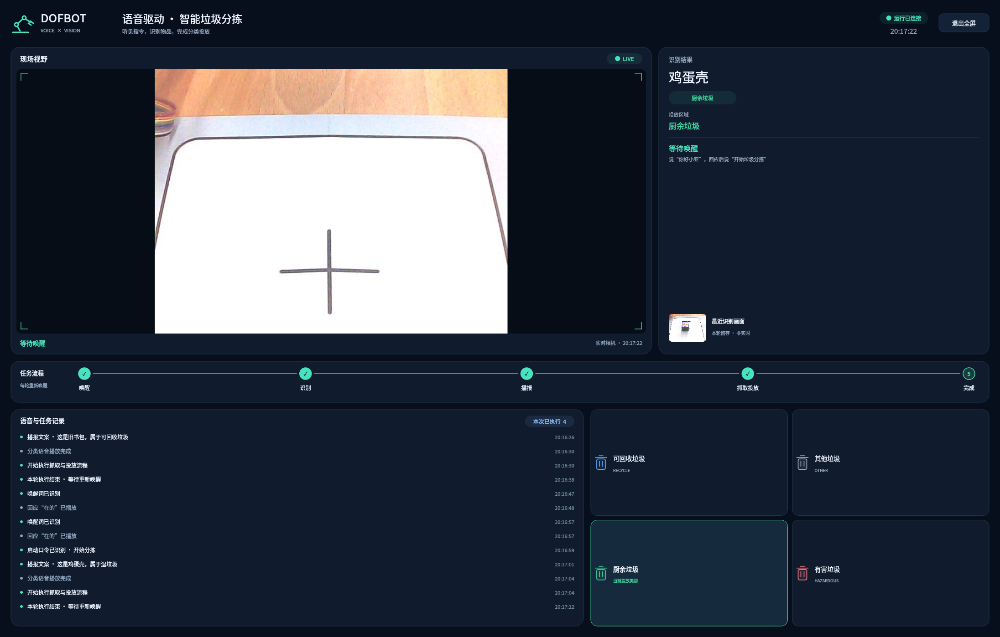
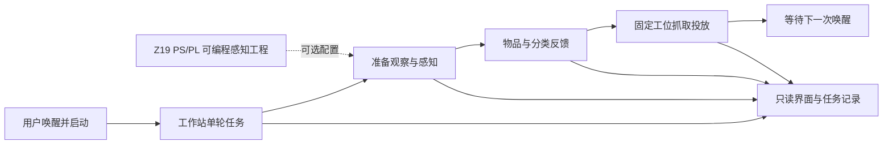
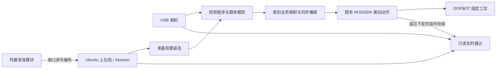

# 芯语智分——基于 Zynq 软硬件协同的语音视觉垃圾分拣系统

**听见指令，看清目标，让分类落到行动。**

硬件平台为 ALINX Z19，器件 `xczu19eg-ffvc1760-2-i`。本报告说明语音视觉分拣任务、PS/PL 计算与接口，以及上位机执行软件的设计。源码、配置与材料版本由 Git 提交与标签记录。

报告按背景、原理、软硬件划分、优化、AI 协作、技能与复现七项展开。配置、版本、依赖与部署状态集中于[配置与兼容性](../docs/CONFIGURATIONS.md)，指标在[证据矩阵](../docs/competition/EVIDENCE_MATRIX.md)维护；[附录 A](#appendix-a)保留固定版本数值，便于独立导出。赛事要求另见[提交规范附件](../docs/competition/requirements_map.md)。

<a id="section-background"></a>
## 1. 选题背景与创新点

一件物品被放入分类容器之前，需要完成识别、判断与投放。芯语智分把语音指令、视觉判断、分类反馈和机械执行组织成固定桌面工位上的单次任务，让使用者在同一界面观察从发起任务到投放结束的过程。

面向校园绿色生活实践，教师或志愿者准备支持的样本与固定拾取台，学生先判断类别，再放置样本、移开手、发出唤醒和启动口令，观察系统播报与投放。面向社区展示，工作人员管理工位，公众按一次唤醒对应一次任务轮流体验。面向嵌入式教学，开发者沿同一任务阅读像素/PCM处理、AXI/FIFO、模型调用和执行接口。完整场景与适用条件见[项目概览](../docs/overview.md)。

项目复用 [Yahboom 识别与语音分拣教程](https://www.yahboom.net/study/DOFBOT_SE/)中的模型、SDK、机构和既有动作，将设计重点放在交互编排、可编程数据处理、接口一致性和工程复用。[TOMRA AUTOSORT](https://www.tomra.com/waste-metal-recycling/products/machines/autosort)与[AMP](https://ampsortation.com/technologies)面向回收设施的连续物料处理，应用层次与本项目的固定桌面交互不同。第三方来源与许可统一见[THIRD_PARTY](../THIRD_PARTY.md)。

团队形成的主要设计包括：

- **有边界的任务**：一次唤醒/启动执行一轮，忙碌输入隔离，播报成功后才进入抓取；USB PCM 在任务边界确认新采音/滤波/ASR 代际。
- **有对应关系的数据**：相机、会话、帧、配置和像素空间逐级关联；原始采集预览、PL 输出与模型输入分开记录。
- **具体的 PL 运算与接口**：RGB 定点校正、HSV、ROI 一阶矩、DC/FIR/软门、FIFO/背压、AXI-Lite 事务及候选状态机。
- **可观察的工程**：控制进程拥有设备，显示旁路只读取数据；识别图、任务事件、运行身份和实际 SDK 指令阶段可追溯。



图1：固定工位分拣界面，显示画面、类别、语音事件和任务阶段。

<a id="section-principle"></a>
## 2. 设计原理与功能框图

### 2.1 产品功能关系



图2：产品功能关系。一次任务按“唤醒→启动→准备→识别→分类播报完成→抓取投放→等待唤醒”进行；可选模块的配置身份见配置页。

### 2.2 固定工位分拣运行配置



图3：固定工位分拣运行关系。检测与任务运行在 Ubuntu 上位机，语音模块输出编号，机械臂沿用固定工位动作。独立 Z19 USB 颜色/网格工程见[对应模块](../fpga/color_locator/README.md)。

### 2.3 四功能源码 profile 的连接关系


图4：`z19-pspl-four-functions-v1` 的源码连接图。像素/PCM 数据通过真实 PIO 路径进入 PL，YOLO 和 Vosk 在 PS CPU；预览旁路来自 PS 采集，不作为模型输入、PL 处理效果或任务许可。该 profile 的运行与依赖条件由系统工程表集中说明。

<a id="section-partition"></a>
## 3. 软硬件划分依据与接口设计

逐像素和逐样本运算具有确定的整数计算与数据次序，适合用 RTL 描述。采集解码、模型框架、词典和坐标配置更依赖 Linux 与软件环境，因此由 PS 组织；上位机保留现有任务、播报和机械执行依赖。完整入口为 [`fpga/system_pspl`](../fpga/system_pspl/README.md)，软件出口为 [`host/app/perception`](../host/app/perception/README.md) 与 [`robot/dofbot/pspl.md`](../robot/dofbot/pspl.md)。

### 3.1 视频预处理与完整帧统计

PS 把解码图像转换为 RGB888，每个 32 位 PIO 字含一像素、SOF 和 EOL。各通道执行：

```text
out = clamp(((pixel * gain_q8_8 + 128) >> 8) + bias, 0, 255)
```

gain 范围为 0..1024，默认 256；bias 范围为 -255..255，默认 0。乘法先无符号舍入，再扩展为有符号数加偏置，最后饱和。模型输入不包含显示用高亮、框线或背景压暗。HSV 算术复用固定版本的 MIT 源码，团队实现外围流控、阈值、配置与统计。

输入只在 ready/valid 实际握手时推进；自由运行 HSV 核的标签逐周期推进，并以信用预留保证结果 FIFO 容量。配置按 staging→校验 commit→pending→accepted SOF active 切换，整帧参数冻结，首像素立即使用所属配置。PS 交替填输入、排输出，不能先塞完整帧，也不沿用旧固定批次假设。

ROI 仅筛选统计，不裁掉像素流。统计包含 count、bbox、sum_x、sum_y：支持最大 4096×4096，32 位 count 足以覆盖像素数，64 位一阶矩覆盖最坏边界。PS 弹出完整帧末像素后才发布快照，累加包含最后一个像素。首个 SOF 前、行长/EOL 不符或未完整结束的帧不生成有效完整统计；读取快照并 ACK 后才接纳下一帧。细节见[视频模块](../fpga/perception_v2/README.md)。

### 3.2 真实分类、定位和候选

`Detector` 显式调用外部真实 Ultralytics CPU 后端，保留厂商外层 640×480 BGR 预处理约定；后端负责自身 letterbox、归一化和 NMS，PS 解码实际结果并恢复外层缩放。神经网络 class ID 顺序来自匹配权重/类序契约，业务类别映射不能替代模型类序。权重缺失、后端不匹配与空检测结果是不同状态。

定位分别保留检测框中心和颜色匹配像素质心：后者由 `sum_x/count`、`sum_y/count` 得到，count=0 时为空。平面映射采用带相机、图像尺寸、transform 与 calibration_id 的单应矩阵；无匹配标定保留像素坐标和原因。桌面 `table_xy_mm` 不解释为机械臂基座三维姿态。

默认 `semantic_bbox` 把唯一真实检测目标的整数框区域及 `bbox_area_px` 交给既有 PL 门控。`color_association` 才执行 ROI 掩码清零、连通区域及包含关系检查，并使用 `pl_mask_pixels`。默认模式输出 `association.state=not_requested`、`reason=semantic_bbox_policy`，不调用仅用于颜色对应的连通域分析；PL 完整回读、统计合法性和来源/时效校验仍保留。

门控复用 ROI、面积范围、连续合格新帧、固定首帧锚点抖动、超时和一次消费。来源/会话失配、帧身份异常，或标签、模型和配置改变时取消或重建候选段；普通连续新帧按规则累计。许可是任务数据，不代表夹持成功或机械安全认证。现有 SDK 类别动作继续使用固定拾取位置，不把新像素中心代入任意位置抓取。

### 3.3 语音与数字滤波

串口语音模式读取外接模块编号；USB PCM 模式读取 16 kHz、mono、S16_LE 音频，经过 PL DC、63 抽头 FIR 和可选软噪声门后由 PS Vosk 解析白名单事件。两者互斥选择，交互语义统一为“你好小亚”及“开始垃圾分拣”。

核心计算为：

```text
d[n] = x[n] - x[n-1] + (32604/32768) * d[n-1]
z[n] = sum(h[k] * d[n-k]), k=0..62
```

DC 使用 40 位 Q24.15 状态与充分扩展的反馈乘积；FIR 系数为 Q1.15、48 位累加。纯数学设计函数提供 Blackman 窗带通 sinc 系数，初始频带为150–6500 Hz、在1 kHz归一化，完整装载并 commit 后才使能。软门以双阈值、包络和逐样本 attack/release 改变 UQ1.15 增益，默认关闭；定点舍入统一为最近、半值远离零。普通 PCM 块边界保持状态，断流或任务语音边界重建采音/滤波/ASR 代际。参数、位宽与源码见[音频模块](../fpga/audio_frontend/README.md)。

### 3.4 公共传输、服务和只读展示

寄存器偏移与位字段由[单一清单](../fpga/system_pspl/registers.json)定义；AXI-Lite 独立接收 AW/W，保持 B/R 响应，非法访问显式报错。C 客户端通过显式 UIO 节点执行有序 32 位 MMIO，核对设备 ID、协议、容量、读写数量和帧标签。超时/断流终止会话，不把部分结果当完整帧或静默切为软件处理。

PS 服务和 VM 客户端按 task/session/frame 绑定 JSON，使用显式地址、限长报文与超时。只传生产端年龄，接收端叠加自身请求耗时，不直接相减跨机单调时钟。新 VM 入口接入原状态与识别图回调，使用独立输出目录；预览图、来源身份与 generation 同快照对应。原部署应用文件和清单保持冻结版本，当前安装器默认从独立保存的 payload 读取它们。

<a id="section-optimization"></a>
## 4. 优化过程及性能/资源对比

优化材料按相同统计范围组织。所有可引用数值及其原始报告入口以[证据矩阵](../docs/competition/EVIDENCE_MATRIX.md)为唯一维护位置；下表说明比较对象和设计判断，[附录 A](#appendix-a)保留供独立导出使用的同源性能与资源数值。

| 对象 | 原路径/基线 | 改进或取舍 | 对应结果与比较条件 |
|---|---|---|---|
| 旧 Z19 颜色系统发布 | hd 模式以 1280×720 进入 PL | balanced 保留原视野，降低 PL 处理尺寸至 640×360 | 见矩阵“原 hd 发布”“balanced 发布率/采集至发布”；分辨率不同，按系统取舍记录 |
| 控制与界面争用 | 控制拥有相机与取帧语义 | 实时画面使用不消费控制游标的旁路，状态和图片独立发布 | 见矩阵“语音任务与展示”及部署记录 |
| 默认语义候选 | 原源码仍执行仅用于颜色关联的掩码复制和连通域分析 | 本收尾版本仅在显式颜色模式执行；语义分支保留结构化 `not_requested` 状态 | 该修正改变候选路径，既有性能数值按原配置保留 |
| 定点与资源选择 | 像素流、音频流、候选状态机计算性质不同 | FIR 使用时分复用乘加，有限 FIFO 按握手流控，位宽按边界推导 | 集成工程完成 100 MHz 完整实现：7,292 LUT、8,882 FF、14 DSP，WNS +0.632 ns |
| 原有资源报告 | 旧颜色完整实现与门控独立 OOC 分别存在报告 | 按各自顶层、器件、约束和报告阶段引用 | 见矩阵“原颜色链完整实现”“门控综合资源/综合网表时序”；两组数字按各自阶段引用 |

四功能集成工程已在 Vivado 2020.1 下完成综合、实现与 bitstream 生成，资源与时序结果见上表；原始报告见[构建记录](../deliverables/fpga_build_20261031/README.md)。板端颜色/网格记录、软件检查和 RTL 仿真按各自版本保留，与构建结果分列。

<a id="section-ai"></a>
## 5. 大模型协作记录

大模型协作用于开发与审阅，不是把运行时 YOLO、Vosk 与 PL 分工改名。真实案例、任务出处、用户审计与修正提交见 [AI 协作记录](ai_collaboration.md)；[原始交互摘录](ai_interaction_excerpt.md)保留11条实际消息、日期/角色/原文本哈希和审计建议节。原会话模型字段记录为 `gpt-6.1-sol`。摘要与原始摘录分开，不补写缺失回答。

| 开发中的发现 | 人工判断与修订 | 可追溯记录 |
|---|---|---|
| 指定颜色成为所有垃圾共同门槛 | 默认选择语义框候选，显式颜色模式保留其适用条件 | [颜色策略案例](ai_collaboration.md#case-color-policy) |
| 唤醒词不一致、旧 PCM/ASR 可能跨任务完成 | 统一用户命令，区分串口和 PCM，增加生产端代际边界确认 | [语音边界案例](ai_collaboration.md#case-voice-boundary) |
| 可选入口缺少展示与日志、图像来源可能错配 | 接回原发布器/控件，独立状态路径，锁定图片与来源身份 | [只读可观测性案例](ai_collaboration.md#case-readonly-observability) |
| 模型环境参数被猜测或混用 | VM 来源与 AArch64 目标环境分离，按实际资料登记并严格核对 | [模型契约案例](ai_collaboration.md#case-model-contract) |

协作流程为任务约束与源码输入→Codex 形成工程→用户/人工审计指出矛盾→按证据修改→保留差异、出处与失效条件。修订以提交差异、源码路径与接口检查记录，均在固定 SHA 下可复核。

<a id="section-skill"></a>
## 6. 技能包提炼过程

技能以陌生队伍能否复用为组织原则，不复制整套工程。每项写明输入/输出、步骤、可改参数、失效条件、来源观察和已有证据；普通 Skill 是本赛道提交要求，通用 PYNQ Skill 是独立加分方向。当前 UIO/PIO 工程没有伪装为 PYNQ Overlay。

| 技能 | 从何处提炼 | 跨题目可复用的部分与边界 |
|---|---|---|
| [stream_frame_contract](../skill/stream_frame_contract/SKILL.md) | 原颜色核自由运行、背压标签与完整统计的工程经验 | 帧契约、信用预留、SOF 参数快照；需重新确认算子延迟和最大帧尺寸 |
| [register_contract](../skill/register_contract/SKILL.md) | AXI 地址/数据独立握手与寄存器投影一致性 | 单一定义、事务原子性、错误/超时及收发次序；不替代目标平台实际 MMIO 映射 |
| [voice_task_boundary](../skill/voice_task_boundary/SKILL.md) | 一次任务与忙碌输入、旧采音/ASR 事件跨代际问题 | 事件身份、边界确认、取消与重复处理；串口和原始 PCM 必须分别适配 |
| [readonly_observability](../skill/readonly_observability/SKILL.md) | 控制与 UI 争用、旧图片/新身份不一致问题 | 单一设备所有者、旁路、进程/会话/图像一致性；显示证据不等于物理成功反馈 |

原颜色链和 DOFBOT 的既有记录说明经验来源；新生成器、新边界与新 profile 的源码、接口和构建结果分别记录。各项 Skill 的适用范围以各自 `SKILL.md` 写明的失效条件为准。

<a id="section-reproduce"></a>
## 7. 从零复现说明

先在[配置与兼容性](../docs/CONFIGURATIONS.md)选择复现对象，再准备对应依赖与工具。以下分别给出冻结应用、独立模块和集成源码的入口。

1. **取得并固定版本。** 本次源码与正式材料以 `xinyu-submission-materials-20261030` 标签固定，按标签解析并记录交付 SHA。`track33-source-20261030` 保留为更名前的历史源码发布，不能代替当前完整文档版本。原分拣演示的[冻结 payload](../deliverables/dofbot_demo_20261029/README.md)仍来自 `8a2a6fd544cb6b79e868b8a710dc34b6027c6c8d`，并保留原安装文件哈希；当前安装器默认读取它，开发目录中的可选接口独立维护。

   ```bash
   git clone https://github.com/Citlali6/VisionGrasp-Z19.git
   cd VisionGrasp-Z19
   git fetch origin tag xinyu-submission-materials-20261030
   git switch --detach xinyu-submission-materials-20261030
   git rev-parse HEAD
   git rev-parse 'refs/tags/xinyu-submission-materials-20261030^{commit}'
   # 两个 SHA 应一致；另行保存该 SHA、配置和依赖版本。
   ```

2. **准备合法依赖和目标环境。** 按配置页取得 VM SDK/动作/媒体，以及匹配的模型权重、真实有序类名、框架修改和来源契约。分别确认 VM 来源环境与板端 AArch64 Linux/Python/库，不能复制 x86 二进制充当 AArch64 依赖。缺少权重、类序或契约时停止相应路径，保留明确错误；不以样例 manifest、固定类别或随机框代替。

3. **选择原部署复现时，使用当前安装器与冻结 payload。** 在配套 Ubuntu/ROS 环境从当前源码根目录，按[快速开始](../docs/QUICKSTART.md)和[VM 组件说明](../robot/dofbot/README.md)执行以下入口。安装器继续按原清单核对 payload，并记录实际来源；缺失或校验失败即停止，不回退到开发目录。现用程序仍运行时不覆盖它；这条路径使用原串口语音和 VM 检测，不需要新 profile。

   ```bash
   bash robot/dofbot/install.sh --check
   bash robot/dofbot/install.sh
   ```

   独立旧检出仍是可选历史复现方式：可用 `git worktree add ../visiongrasp-demo-20261029 8a2a6fd544cb6b79e868b8a710dc34b6027c6c8d` 保存旧源，再为当前安装命令显式传入 `--source ../visiongrasp-demo-20261029/robot/dofbot`，沿用相同文件与环境校验。旧 Z19 颜色/MIPI 则分别按各自模块说明、产物哈希及工具版本操作。

4. **选择四功能 profile 时，准备匹配的工程工具。** 指南推荐 Vivado/Vitis 2026.1 或 2025.2；当前颜色/新 profile 脚本固定 2020.1，以保留既有 ALINX PS/IP 配置，独立 MIPI 要求另列于工程表。本稿在 2020.1 完成完整构建，资源与时序见[构建记录](../deliverables/fpga_build_20261031/README.md)；推荐版本未重建，不隐式升级 IP。

   ```bash
   # 从当前交付源码根目录；输出放在源码树之外并使用未占用目录：
   vivado -mode batch -source fpga/system_pspl/create_project.tcl -tclargs /outside-source/pspl
   vivado -mode batch -source fpga/system_pspl/build_bitstream.tcl -tclargs /outside-source/pspl/project/z19_pspl_four_functions.xpr /outside-source/pspl/system_pspl.xsa
   ```

5. **为实际 Linux 目标构建传输库。** 准备匹配 sysroot 与 AArch64 编译器，设置工具链所读取的 `Z19_SYSROOT`，再构建 C 库。原 VM x86 库和旧 XSA 均不能替代本目标的新产物。

   ```bash
   cmake -S host/libpspl -B /outside-source/pspl-c -DCMAKE_TOOLCHAIN_FILE="$PWD/host/libpspl/aarch64-linux.cmake"
   cmake --build /outside-source/pspl-c
   ```

6. **按真实资料登记模型。** 对来源权重/YAML、框架文件、前后处理和目标环境准备 `visiongrasp.vm-backend-contract/1` 契约，再使用实际参数登记。工具只负责形成加载契约，登记成功不代表推理或目标兼容性已验证。

   ```bash
   python3 -m host.app.perception.enroll_model --weights /legal/best.pt --framework-root /legal/ultralytics --names-yaml /legal/data.yaml --source-contract /private/source_contract.json --output /private/model_manifest.json
   ```

7. **核对硬件平台与 Linux 集成。** 按 `profile.json`、`pspl-uio.dtsi` 和实际目标 Linux 的集成方式配置 bit/XSA、设备树与 UIO；核对器件、时钟/复位、保留地址、设备 ID/协议及 map 尺寸，显式选择对应设备节点。

8. **填写 PS/VM 私有配置。** 从真实示例复制并替换所有 `REQUIRED` 字段，配置模型清单、库、相机 by-id、明确 UIO、两端相同的 `candidate_policy`、语音来源、绑定地址与 token。VM 跨机连接时 PS 地址需可达；`runtime_root` 放在源码/安装目录之外。无匹配标定时保留像素输出，`calibration=null` 不是毫米标定。USB PCM 需另备麦克风、ALSA 与覆盖任务词的 Vosk 模型；串口编号不经过 FIR。

9. **启动所选新路径。** PS 从当前交付源码根目录使用 `python3 -m host.app.perception.service --config /private/pspl-service.json`。VM 使用 `/usr/bin/python3 -B /absolute/path/robot/dofbot/pspl_entry.py --config /private/vm-pspl.json`，按 [PSPL说明](../robot/dofbot/pspl.md)选择是否显式执行机械臂及打开只读窗口。旧部署保持独立，不能同时争用设备。任务图像、来源 JSON、事件、实际指令记录和软件错误进入该新入口的独立输出目录。

10. **保存可复核输出。** 按对应输入与版本核对 RGB/掩码/一阶矩/PCM、模型结果与参考数据，保存配置、输入、原始输出、工具报告及失败记录；分别记录软件、RTL、完整实现和板级结果。新记录进入证据矩阵时附上对应配置、源码与测量条件。

<a id="appendix-a"></a>
## 附录 A. 性能与资源数值快照

本附录从同一证据矩阵手工转录，用于报告脱离仓库单独导出时保留数值、条件和证据范围。它不是第二个指标维护源。

| 快照标识 | 固定值 |
|---|---|
| 来源文件 | `docs/competition/EVIDENCE_MATRIX.md` |
| 维护与导出规则 | 数值只在证据矩阵维护；矩阵更新后从当前版本重新转录本附录。 |

### A.1 旧颜色系统的配置取舍

以下是 2026-10-23 独立颜色/网格配置的系统记录；采集至发布包含采集、PS 解码/传输/编码和发布路径，不是 PL 算术延迟。

| 配置 | 原图尺寸 | PL 处理尺寸 | 板端平均发布率 | 采集至发布 | 原始证据 |
|---|---|---|---|---|---|
| 原 hd | 1280×720 | 1280×720 | 1.924 fps | 567.99 ms | [网格与预览记录](https://github.com/Citlali6/VisionGrasp-Z19/blob/19a09b90b5100dc99c5a5b3ecf07853063c3a011/docs/log/2026-10-23-grid-preview.md)，证据矩阵“原 hd 发布” |
| balanced | 1280×720 | 640×360 | 7.26 fps | 约 187 ms | 同一记录，证据矩阵“balanced 发布率”“balanced 采集至发布” |

balanced 保留原始视野，减少进入 PL 的像素，并牺牲处理图的小目标细节。两行处理分辨率不同，不能据此计算同画质算法加速比，也不能将其发布率赋予新四功能 profile。

### A.2 已有资源与时序报告

下表并列报告三个工程范围，**不构成资源优化前后对照**：原颜色为完整镜像的实现结果，门控为独立 OOC 综合，四功能为集成工程完整实现。不同顶层、不同报告阶段的结果分别引用。

| 工程及日期 | 器件 / 工具 | 报告阶段 | LUT | FF | BRAM | DSP | WNS / WHS | 原始证据 |
|---|---|---|---:|---:|---:|---:|---|---|
| 原颜色链，2026-10-22 | XCZU19EG-FFVC1760-2 / Vivado 2020.1 | 完整实现、布局布线 | 1,885 | 1,936 | 0 | 6 | 4.580 ns / 0.017 ns | [资源](https://github.com/Citlali6/VisionGrasp-Z19/blob/19a09b90b5100dc99c5a5b3ecf07853063c3a011/deliverables/pl_color_z19/validation/utilization.rpt)、[时序](https://github.com/Citlali6/VisionGrasp-Z19/blob/19a09b90b5100dc99c5a5b3ecf07853063c3a011/deliverables/pl_color_z19/validation/timing.rpt) |
| 四功能集成工程，2026-10-31 | XCZU19EG-FFVC1760-2-I / Vivado 2020.1 | 完整实现、布局布线、bitstream | 7,292 | 8,882 | 0 | 14 | +0.632 ns / +0.010 ns | [构建记录](../deliverables/fpga_build_20261031/README.md) |
| 独立候选门控，2026-10-29 | XCZU19EG-FFVC1760-2-I / Vivado 2020.1 | OOC 综合、综合网表时序；未布局布线 | 866 | 949 | 0 | 0 | 7.112 ns / 0.061 ns | [资源](https://github.com/Citlali6/VisionGrasp-Z19/blob/19a09b90b5100dc99c5a5b3ecf07853063c3a011/fpga/sort_guard/validation/reports/utilization.rpt)、[时序](https://github.com/Citlali6/VisionGrasp-Z19/blob/19a09b90b5100dc99c5a5b3ecf07853063c3a011/fpga/sort_guard/validation/reports/timing_synth_only.rpt)、[结果及哈希](https://github.com/Citlali6/VisionGrasp-Z19/blob/19a09b90b5100dc99c5a5b3ecf07853063c3a011/fpga/sort_guard/validation/result.json) |

门控在综合后施加 10 ns 报告约束；67 个输入、40 个输出未设置 I/O delay，`HD.CLK_SRC` 未设置。其裕量属于综合估计，不是完整实现收敛、实测板上频率或吞吐。原颜色报告与门控报告各自的约束和工具阶段继续随原文件保留。

### A.3 新 profile 的数值边界

`z19-pspl-four-functions-v1` 于 2026-10-31 在 Vivado 2020.1 完成综合、实现与 bitstream 生成：7,292 LUT、8,882 FF、14 DSP、0 BRAM，100 MHz 下 WNS +0.632 ns、WHS +0.010 ns，0 失败端点；DRC 无 Critical/Error。功耗 4.167 W 为 vectorless 估算。原始报告见[构建记录](../deliverables/fpga_build_20261031/README.md)。
